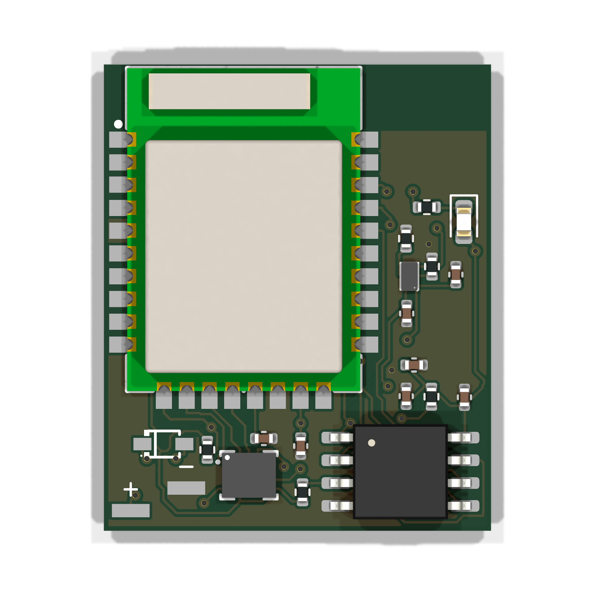
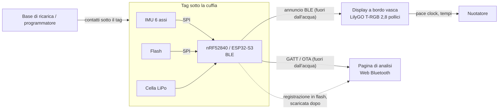

# SwimTimer (repository privato della scheda nRF52840)

Tempi automatici in piscina: un tag sotto la cuffia e un display a bordo vasca riconoscono partenza e arrivo, senza pulsanti.

   

Aggiornato al **2026-11-04**. Questo è il repository **privato** `PZero/SwimTimer-nrf52840`: contiene tutto il repository pubblico `PZero/SwimTimer` più il progetto hardware della scheda su misura (KiCad, Gerber, programmatore, sfondi tecnici).



## Indice
- [Cos'è SwimTimer](#cosè-swimtimer)
- [Stato attuale](#stato-attuale)
- [Architettura del sistema](#architettura-del-sistema)
- [Prototipo ESP32, firmware 0.4.3 e pagina di analisi](#prototipo-esp32-firmware-043-e-pagina-di-analisi)
- [Tag nRF52840](#tag-nrf52840)
- [Programmatore HAT per Raspberry Pi](#programmatore-hat-per-raspberry-pi-34)
- [Galleria degli sfondi tecnici](#galleria-degli-sfondi-tecnici)
- [Struttura delle cartelle](#struttura-delle-cartelle)
- [Come rigenerare i file](#come-rigenerare-i-file)
- [Flusso d'ordine JLCPCB](#flusso-dordine-jlcpcb)
- [Roadmap e problemi aperti](#roadmap-e-problemi-aperti)
- [Privacy e sicurezza](#privacy-e-sicurezza)
- [Licenza e autore](#licenza-e-autore)

## Cos'è SwimTimer

**Problema.** In piscina i tempi per vasca e i riposi si perdono. Guardare l'orologio o premere un pulsante interrompe l'allenamento.

**Soluzione.** Un piccolo tag con sensore inerziale (accelerometro e giroscopio) si indossa sotto la cuffia. Riconosce da solo la spinta dal muro (partenza), le virate e la calma all'arrivo. Un display a bordo vasca mostra i tempi.

**Vincolo fisico.** Il BLE a 2,4 GHz non attraversa l'acqua. Il tempo non si misura col segnale radio: lo decide il sensore sul tag. Il BLE serve solo fuori dall'acqua, per riconoscere la vicinanza al display e inviare i dati. Analisi completa: [`docs/IDEA.md`](docs/IDEA.md).

## Stato attuale

| Area | Stato |
|---|---|
| Prototipo ESP32-S3 + BMI160, firmware **0.4.3**, pagina di analisi | Funzionante sul tavolo; prove in vasca non ancora fatte |
| Display LilyGO T-RGB (pace clock a 4 lancette) | Funzionante sul tavolo |
| Tag nRF52840 **v0.4 "economica"** | In chiusura. 21,59 × 26 mm, 2 strati, DRC 0 prima dell'ultima modifica |
| **Aggiunta del TPS22916C** (interruttore di alimentazione dell'IMU) | **In corso**: schema, PCB e script sono nel commit WIP, **non verificati** (DRC non rifatto) |
| Ordine a JLCPCB | **Non ordinare** finché la scheda con il TPS22916C non è verificata |
| Programmatore HAT per Raspberry Pi 3/4 | Progettato, DRC 0; **non ancora costruito** |

## Architettura del sistema



- **Tag.** Sotto la cuffia, premuto sul cranio. Decide da solo START, virate e STOP con l'IMU e registra i dati grezzi in flash.
- **Display a bordo vasca.** Riceve gli annunci BLE del tag senza collegarsi. Mostra un pace clock a 4 lancette. Va in sonno dopo 5 minuti senza tag.
- **Pagina web.** `tools/index.html`: dati dal vivo, registrazioni, calibrazione, aggiornamento firmware via Bluetooth.
- **BLE fuori dall'acqua.** Sott'acqua il segnale sparisce in pochi centimetri: durante la nuotata il tag lavora da solo e consegna i dati quando emerge o a fine sessione.

## Prototipo ESP32, firmware 0.4.3 e pagina di analisi

Il prototipo serve a mettere a punto gli algoritmi prima della scheda su misura.

**Tag (prototipo).** ESP32-S3 SuperMini + BMI160 (GY-BMI160), LiPo con interruttore generale. Distinta: [`hardware/bom.md`](hardware/bom.md). Collegamenti: [`hardware/schema.md`](hardware/schema.md).

**Firmware 0.4.3** (`firmware/test-collegamenti`, arduino-cli, core `esp32:esp32` 3.3.12):
- ±16 g e 100 Hz, impostati a sensori accesi e riletti (fino a 5 tentativi);
- flash con due copie del programma e circa 1,9 MB di LittleFS (circa 40 minuti a 50 Hz);
- doppio tap = inizio registrazione, triplo tap = fine (rilevamento software, poco affidabile: circa 1 volta su 10);
- BLE con dati, stato, comandi, OTA e versione; stessi comandi via USB; aggiornamento via Bluetooth con ritorno automatico alla versione precedente;
- sblocco automatico del bus I2C, LED RGB come riscontro, motivo dell'ultimo riavvio, partitori su GPIO 1 (batteria) e GPIO 2 (pin 5V).

**Pagina di analisi** [`tools/index.html`](tools/index.html), online su <https://pzero.github.io/SwimTimer/> (GitHub Pages del repository **pubblico**, firmware 0.4.3 pubblicato):
- schede "Dal vivo" (batteria, orientamento 3D, radar con scia di 15 s, interpretazione, eventi, grafici) e "Registrazioni";
- calibrazione automatica, finestre Firmware e LED, modalità Demo;
- Bluetooth (Chrome, Edge, Bluefy su iPhone) o USB;
- card batteria con grafico di GPIO 1, GPIO 2 e tensione stimata a riposo.

`tools/assi.html` è la vecchia pagina dei 3 assi, conservata.

**Display** (`firmware/display-prova`): LilyGO T-RGB 2,8 pollici, PlatformIO con espressif32 6.9.0, driver copiato e adattato in `src/trgb/` (licenza MIT, Xinyuan-LilyGO).

**Compilare e caricare il tag:**
```
arduino-cli compile --fqbn esp32:esp32:esp32s3:CDCOnBoot=cdc --upload -p <COM> firmware/test-collegamenti
```

Documenti collegati: [`docs/RICERCA-ALGORITMI.md`](docs/RICERCA-ALGORITMI.md), [`docs/LEZIONI-APPRESE.md`](docs/LEZIONI-APPRESE.md) (13 lezioni del prototipo per la scheda miniaturizzata), [`docs/REQUISITI.md`](docs/REQUISITI.md), [`docs/DESIGN.md`](docs/DESIGN.md).

## Tag nRF52840

**Obiettivo.** Sostituire il prototipo con un tag miniaturizzato per la cuffia, montato da JLCPCB, con ricarica a contatto e programmazione dalle piazzole sul lato sotto. Documento di progetto: [`hardware/nrf52840/progetto.md`](hardware/nrf52840/progetto.md).

### Storia delle versioni

| Versione | Data | Scheda | Contenuto | Esito |
|---|---|---|---|---|
| v0.1 | 2026-10-25 | 17,5 × 20,5 mm, 4 strati | Raytac MDBT50Q, LSM6DSV16X, MS5837, flash 32 MB, BQ25101, vibratore | Sostituita |
| v0.2 | 2026-10-25 | 17,5 × 22,5 mm, 4 strati | Aggiunti TVS, Schottky e reset all'inserimento nella custodia; DRC 0 | Storico |
| v0.3 collaudo (1c) | 2026-11-01 | 26 × 30 mm, 4 strati 0,8 mm | Ebyte E73 (Raytac a stock 0), TPS22916C, MAX17048, cella Ampul 401012 su JST SH, Tag-Connect, piazzole di prova; vibratore non montato; DRC 0, 609 piste, 80 via | Pronta, mai ordinata (~120–130 $) |
| v0.4 economica | 2026-11-02 | 22,86 × 26 mm, 2 strati | Solo registrazione IMU, budget ≤ 100 €: tolti pressione, MAX17048, TPS22916C, vibratore, Tag-Connect, TVS; flash 16 MB | Ricompattata |
| v0.4 ricompattata | 2026-11-03 | **21,59 × 26 mm**, 2 strati | LED 0603 *basic* con anodo su VDD, pinout cambiato, DRC 0, file JLC rigenerati | Verificata (65 test, 0 bloccanti) |
| v0.4 con TPS22916C | 2026-11-03/04 | come sopra | Interruttore di alimentazione dell'IMU (richiesta dell'utente; MAX17048 no) | **In corso, non verificata** |

### v0.4 in dettaglio

**Scopo.** Due prototipi per registrare i dati grezzi dell'IMU e mettere a punto i filtri, spesi il meno possibile. Dati in `kicad/dati_economica.py`, posizioni in `kicad/posizioni_economica.py`, disegno quotato in [`hardware/nrf52840/ingombro_v0.4.svg`](hardware/nrf52840/ingombro_v0.4.svg).

**Misure.** Scheda **21,59 × 26,0 mm** (8,5 passi da 2,54 mm), **2 strati**, 0,8 mm, componenti solo sopra, 313 piste, 29 via. Tag finito circa 25 × 29 mm con 1,5 mm di resina. A 20,32 mm lo sbroglio a 2 strati non chiude (circa 100 prove con Freerouting, mai DRC 0).

**Componenti (codici LCSC):**

| Funzione | Componente | LCSC | Tipo JLC |
|---|---|---|---|
| Microcontrollore e BLE | Ebyte E73-2G4M08S1C (nRF52840), VDDH dalla cella, REGOUT0 a 3,3 V da UICR | C356849 | extended |
| IMU 6 assi | ST LSM6DSV16X, SPI con INT1/INT2 | C5267406 | extended |
| Flash 16 MB | Winbond W25Q128JVSIQ, SOIC-8, SPI semplice | C97521 | basic |
| Caricatore | TI BQ25101 (TS 10 kΩ a massa, ISET 10 kΩ = 13,5 mA) | C478468 | extended |
| LED | KT-0603R rosso, anodo su VDD | C2286 | basic |
| Protezione ricarica | Schottky 1N5819WS in serie ai contatti | C191023 | basic |
| Cella | Header SMD 1,27 mm 1 × 2 (fili saldati alla cella) | C55213900 | extended |
| Passivi | 6 resistenze, 7 condensatori | vedi `bom_jlc.csv` | basic |
| In corso | TPS22916C per l'alimentazione dell'IMU (nel WIP) | C2680319 | da verificare |

Distinta completa e rotazioni: `hardware/nrf52840/kicad/jlc/v0.4_swimtag_economica/` (`bom_jlc.csv`, `cpl_jlc.csv`). Altre alternative valutate (flash WSON, JST SH, NTC): [`hardware/nrf52840/progetto.md`](hardware/nrf52840/progetto.md).

**Lato sotto, griglia 2,54 mm** (millefori e pogo):

| Piazzola | Rete | x (mm) | y (mm) | Ø |
|---|---|---|---|---|
| TP1 | VDD (solo riferimento) | 5,08 | 12,70 | 2,0 |
| TP2 | SWDIO | 7,62 | 12,70 | 2,0 |
| TP3 | SWDCLK | 10,16 | 12,70 | 2,0 |
| TP4 | RESET | 12,70 | 12,70 | 2,0 |
| TP5 | GND | 15,24 | 12,70 | 2,0 |
| TP6 | VIN (ricarica) | 7,62 | 17,78 | 2,5 |
| TP7 | GND (ricarica) | 12,70 | 17,78 | 2,5 |

Coordinate dall'angolo in alto a sinistra (lato antenna), scheda vista da sopra. Tacche di serigrafia ogni 2,54 mm sui bordi sinistro e alto.

**Pinout per il firmware** (tutti i segnali a 3,3 V dopo REGOUT0). Tabella completa in [`hardware/nrf52840/verifica_v0.4.md`](hardware/nrf52840/verifica_v0.4.md), sezione 3.

| Pad E73 | GPIO | Rete | Note |
|---|---|---|---|
| 11 | P0.00 | IMU_CS | R6 100 kΩ a VDD; pin XL1: **LFCLK non da XTAL** |
| 13 | P0.01 | IMU_MISO | pin XL2 |
| 15 | P0.05 | IMU_MOSI | |
| 17 | P1.09 | IMU_SCK | SPI fino a 8 MHz |
| 12 | P0.26 | IMU_INT1 | |
| 14 | P0.06 | IMU_INT2 | |
| 30 | P0.17 | FL_CS | R5 100 kΩ a VDD |
| 28 | P0.15 | FL_MISO | |
| 33 | P0.13 | FL_MOSI | |
| 35 | P0.24 | FL_SCK | /WP e /HOLD alti: solo SPI semplice |
| 32 | P0.20 | CHG_N | pull-up interno; basso = in carica |
| 34 | P0.22 | LED | acceso a livello basso, circa 1,4 mA |
| 26 | P0.18 | RESET | dopo la scrittura di `UICR.PSELRESET` |
| 37 / 39 | SWDIO / SWDCLK | SWD | pogo TP2 / TP3 |
| 23 | VDDH | VBAT | batteria con canale SAADC `VDDHDIV5`, nessun partitore |

Il pinout è cambiato il 2026-11-03 (CHG_N, LED, INT1, INT2). Il pin di abilitazione del TPS22916C sarà aggiunto a verifica conclusa. Registri UICR da scrivere una volta via SWD: `REGOUT0` (0x10001304) = `0xFFFFFFFD` (3,3 V), `PSELRESET[0]` e `[1]` (0x10001200 / 0x10001204) = `0x12`.

**Scelte principali.**
- **Flash 16 MB** SOIC-8 *basic*: 4,93 $ per 2 schede contro 9,83 $ del WSON. Durata: circa 24 minuti a 960 Hz (sei assi, 16 bit), circa 97 minuti a 240 Hz, circa 3 ore a 120 Hz.
- **LED 0603 *basic*** con anodo su VDD: toglie 3,07 $ di caricamento extended e non inietta corrente nel pin al primo avvio (VDD a 1,8 V con UICR vuoto).
- **Header SMD 1,27 mm** al posto del JST SH: 10,4 contro 26,6 mm², costa meno.
- **2 strati, HASL senza piombo**: lo sbroglio chiude senza toccare la zona antenna (3,7 mm senza rame).
- **Tolti:** pressione (manca la profondità; avvisare l'agente app se serve), MAX17048, vibratore, Tag-Connect, TVS, reset all'inserimento.

**Costi reali dal carrello JLC** (2026-11-03, scheda 22,86 × 26 mm, prima del LED *basic* e del TPS22916C). E73, IMU (LGA) e BQ25101 (BGA) sono montabili **solo in Standard PCBA**, non nell'Economic:

| Voce | € |
|---|---|
| 5 PCB 2 strati HASL (offerta) | 1,79 |
| Setup Standard | 23,02 |
| Stencil | 7,39 |
| Componenti per 2 schede | 26,95 |
| Caricamento extended (5 tipi) | 16,63 |
| Montaggio SMT | 0,66 |
| Raggi X | 8,85 |
| Imballo | 0,45 |
| Spedizione | 9,62 |
| IVA, dazio temporaneo e diritti di gestione Ue | 31,32 |
| **Totale** | **128,46** |

Riduzioni: coupon *PCBA Special Offer* (−8,05 €, scade il 2026-11-29) e *JLCONE PCB* (fino a −1,79 €), LED *basic* già fatto (circa −4 € con IVA). Il TPS22916C aggiunge un caricamento extended (circa +4,5 € con IVA). Stima attuale circa **110–115 €** con raggi X: il tetto di 100 € si raggiunge solo togliendo i raggi X (sconsigliato) o l'header della cella.

### Verifica indipendente

Documento: [`hardware/nrf52840/verifica_v0.4.md`](hardware/nrf52840/verifica_v0.4.md). Eseguita il 2026-11-03 da un agente revisore sul commit `8fd6cc0`, con `kicad-cli` 10.0.6 e lo script `kicad/verifica_v04.py` (tabella attesa scritta a mano dai fogli tecnici).

**Esito: 65 test, 0 difetti bloccanti.** Netlist 85 pin attesi, 0 differenze; PCB e schema coincidono; piedinature e impronte coerenti con i fogli tecnici.

Punti ⚠️ principali:
- **Finitura HASL o ENIG.** HASL con il BGA del BQ25101 a 0,4 mm è sconsigliata da JLC; la verifica raccomanda ENIG (costa di più). È una scelta dell'utente da fare all'ordine.
- **LGA dell'IMU (U2):** orientamento da confermare nell'anteprima JLC e quote dei pad da confrontare col disegno meccanico del DS13510 (non raggiunto).
- **Polarità di LED (D1), Schottky (D2) e header (J1)** e rotazioni di E73, IMU, BQ25101: da confermare nell'anteprima JLC. L'header è simmetrico: nessuna protezione contro l'inversione della cella (marcare i fili).
- **Margine di tensione:** VDD segue VDDH − 0,3 V sotto 3,6 V e la flash vuole almeno 2,7 V: taglio batteria nel firmware a 3,2–3,3 V.
- **Corrente esterna da VDD:** 5 mA con radio sopra +4 dBm: non scrivere in flash mentre il BLE trasmette a potenza alta.
- **Caricatore:** C5 con tensione ≥ 10 V, valutare di togliere C6 o C7; con ingresso 5,0 V e Schottky il margine su VIN-DPM è stretto; il carico durante la carica impedisce la terminazione (timer 10 h).
- **Antenna:** il foglio Ebyte non quota la zona libera; la prova di portata prima della resina è obbligatoria.
- **Firmware:** niente DC/DC, LFCLK dall'RC (P0.00/P0.01 sono usati come GPIO), niente eventi USB.
- **Dopo il TPS22916C** la verifica va rifatta (sezione 4 del documento): rete IMU commutata, pull-up di IMU_CS, ordine di accensione, SPI e INT a livello basso prima di togliere l'alimentazione.

### Documenti collegati
- [`hardware/nrf52840/bom.md`](hardware/nrf52840/bom.md): distinta con codici LCSC e alternative.
- [`hardware/nrf52840/verifiche.md`](hardware/nrf52840/verifiche.md): controlli sui fogli tecnici (v0.2/v0.3).
- [`hardware/nrf52840/SwimTag_v0.3_collaudo.pdf`](hardware/nrf52840/SwimTag_v0.3_collaudo.pdf): PDF storico della v0.3.
- Render v0.4: `hardware/nrf52840/kicad/jlc/v0.4_swimtag_economica/render_sopra.png`, `render_sotto.png`, `render_3d.png`.

## Programmatore HAT per Raspberry Pi 3/4

Basetta a una faccia, da costruire a mano con il **toner transfer**, con forma e fori di un HAT del Raspberry Pi (65 × 56,5 mm). Si innesta sul connettore a 40 pin del Pi 3 o 4. Sette molle **pogo** cadono sulle piazzole sotto il tag: 5 di debug SWD e 2 di ricarica. Il Pi programma con **OpenOCD** in bit-bang sui GPIO e può ricaricare la cella mentre il tag è collegato.


- **Collegamenti sul connettore:** pin 2 (5 V, solo ricarica, via PTC e ponticello), 12 (RESET, GPIO18), 18 (SWDIO, GPIO24), 20 (GND), 22 (SWCLK, GPIO25). Resistenze in serie da 1 kΩ su SWD e RESET.
- **Regola fondamentale:** mai il 3,3 V del Pi sul VDD del tag. Il tag si alimenta dalla cella; al primo avvio il suo VDD è 1,8 V finché non si scrive `UICR.REGOUT0`.
- **Ricarica:** pogo VIN e GND caricano la cella 401012 tramite il BQ25101 (13,5 mA, circa 3–3,5 ore da vuota). Ponticello JP1: nessuno = ricarica spenta (predefinito), 1-2 = 5 V del Pi, 2-3 = 5 V esterno.
- **Centraggio:** tre pin di battuta sui bordi con le tacche del tag, errore stimato circa ±0,3 mm.
- **OpenOCD:** file `swimtag_pi.cfg` (driver `bcm2835gpio`, base periferiche 0x3F000000 per Pi 3 e 0xFE000000 per Pi 4). Pi 5 non supportato.
- **DRC 0, ERC 0** con `kicad-cli` 10.0.6.
- **Non provato fisicamente:** la basetta non è stata costruita. Rischi noti: livelli a 1,8 V sul tag (le 1 kΩ non sono una traduzione di livello), foro dei pogo da verificare sul pezzo, posizione del connettore da verificare su un Pi reale.

**Documentazione:**
- [`hardware/programmatore/Programmatore_SwimTag_v0.4.pdf`](hardware/programmatore/Programmatore_SwimTag_v0.4.pdf): schema, distinta, procedura, OpenOCD. Le stampe 1:1 sono alle pagine 6 (rame speculare), 7 (componenti), 8 (ingrandimento 2:1) e 9 (mappa fori).
- [`hardware/programmatore/README.md`](hardware/programmatore/README.md): dettagli, piedinatura, procedura e limiti.
- [`hardware/programmatore/bom.md`](hardware/programmatore/bom.md): distinta con prezzi.
- [`hardware/programmatore/stampa/`](hardware/programmatore/stampa/): fogli di stampa 1:1.

## Galleria degli sfondi tecnici

Venti tavole da disegno 1170 × 2532 px, generate dai PCB reali (blueprint, OLED, carta tecnica, rame su verde). Fotografie intere in [`hardware/wallpaper_v0.4/png/`](hardware/wallpaper_v0.4/png/) (esistono anche le versioni 1080 × 2400); anteprima d'insieme: [`anteprima.png`](hardware/wallpaper_v0.4/anteprima.png).

| &nbsp; | &nbsp; | &nbsp; | &nbsp; |
|---|---|---|---|
| <br>**01** Pianta del tag | <br>**02** Esploso | <br>**03** Sezione | <br>**04** Dettagli |
| <br>**05** E73 e antenna | <br>**06** E73, piedinatura | <br>**07** Rame superiore | <br>**08** Rame inferiore |
| <br>**09** Maschera e serigrafia | <br>**10** Strati (vista a pila) | <br>**11** Mappa dei fori | <br>**12** Zona di carica |
| <br>**13** Quote e posizioni | <br>**14** Piazzole di servizio | <br>**15** Tre viste | <br>**16** Isometrica con distinta |
| <br>**17** Programmatore, pianta | <br>**18** Programmatore, pogo | <br>**19** Programmatore, HAT | <br>**20** Programmatore, toner transfer |

**Come rigenerarli.** `python hardware/wallpaper_v0.4/genera.py` (richiede `kicad-cli` e PyMuPDF). Opzioni: `--solo 1 3 12`, `--bozza`, `--forza` per rifare anche i render 3D. Gli sfondi vanno **rigenerati** sulla scheda con il TPS22916C, quando sarà verificata. Gli sfondi della v0.3, vecchi e solo storici, sono in [`hardware/nrf52840/wallpaper/png/`](hardware/nrf52840/wallpaper/png/).

## Struttura delle cartelle

```
SwimTimer-nrf52840/
├── docs/                         idea, stato, decisioni, domande aperte, requisiti, design, lezioni, algoritmi
├── firmware/
│   ├── test-collegamenti/        tag ESP32-S3: firmware 0.4.3
│   └── display-prova/            display T-RGB
├── tools/                        index.html (pagina di analisi), assi.html (vecchia)
├── hardware/
│   ├── bom.md, schema.md         prototipo ESP32
│   ├── nrf52840/                 scheda su misura: progetto.md, bom.md, verifiche.md, verifica_v0.4.md,
│   │   │                         ingombro*.svg, PDF e wallpaper della v0.3
│   │   └── kicad/                script, progetti KiCad (swimtag, _collaudo, _economica), jlc/ (file per JLC)
│   ├── programmatore/            HAT per Raspberry Pi: KiCad, PDF, stampe 1:1, script
│   └── wallpaper_v0.4/           genera.py, estrai_dati.py, render/, png/ (20 sfondi)
├── CHANGELOG.md                  modifiche per data
├── CLAUDE.md                     regole di lavoro del progetto
└── README.md                     questo file
```

## Come rigenerare i file

| Cosa | Comando | Note |
|---|---|---|
| Schema e PCB v0.4 | `SWIMTAG_VARIANTE=economica python hardware/nrf52840/kicad/genera_schema.py` e `genera_pcb.py` | dati in `dati_economica.py`, posizioni in `posizioni_economica.py` |
| Sbroglio | `sbroglia.py` | Freerouting 2.5.0, Java 25; non deterministico: ripetere finché il DRC è 0 |
| Controllo netlist | `verifica_netlist.py` | confronta la netlist con i dati |
| Verifica indipendente | `python hardware/nrf52840/kicad/verifica_v04.py <pcb> <net.xml> [cpl.csv bom.csv]` | la tabella ATTESA va aggiornata a mano dai fogli tecnici dopo il TPS22916C |
| File JLC | `SWIMTAG_VARIANTE=economica python hardware/nrf52840/kicad/esporta_jlc.py` | scrive in `jlc/v0.4_swimtag_economica/` |
| Programmatore | `cd hardware/programmatore; python genera_kicad.py --drc` poi `python genera_pdf.py` | rilegge TP1–TP7 dal PCB del tag; PDF richiede PyMuPDF e `kicad-cli` |
| Sfondi | `python hardware/wallpaper_v0.4/genera.py` | vedi galleria |

La v0.3 si rigenera con `SWIMTAG_VARIANTE=collaudo` (predefinita).

## Flusso d'ordine JLCPCB

**Non ordinare** finché la scheda con il TPS22916C non è verificata (DRC/ERC, `verifica_v04.py`, costi ≤ 100 €).

1. Rigenerare i file JLC e controllare `bom_jlc.csv` e `cpl_jlc.csv`.
2. Caricare lo zip dei Gerber (`swimtag_gerber.zip`) nell'ordine PCB: 2 strati, 0,8 mm, **HASL senza piombo oppure ENIG** (scelta dell'utente, vedi verifica).
3. Servizio di montaggio **Standard PCBA** (obbligatorio: E73, IMU e BQ25101 sono "Standard only"), lato sopra, **PCBA Qty = 2**; se chiesto, bordi di lavorazione "Added by JLCPCB".
4. Caricare BOM e CPL e controllare nell'anteprima rotazioni e pin 1 di E73, IMU (LGA), BQ25101 (BGA), flash (U3 a 270°: piedini sulle piazzole), LED (catodo), Schottky e header; stock dell'E73.
5. Applicare i **coupon** dal Coupon Center: *PCBA Special Offer* (8,05 €) e *JLCONE PCB* (ordine dall'app JLCONE).
6. Attivare **Confirm Parts Placement** (0,45 €) per approvare il posizionamento prima della produzione.
7. Aggiungere i raggi **X-ray** per E73, IMU, BQ25101 e gli altri componenti con pad nascosti (circa +10 $).
8. Verificare il totale (obiettivo ≤ 100 € con IVA), poi pagare. Cella, pogo e programmatore sono esclusi.

## Roadmap e problemi aperti

**Scheda nRF52840**
1. Completare il TPS22916C: DRC/ERC, C5 ≥ 10 V, uscita del caricatore 1–10 µF, piste sotto l'E73 su B.Cu, serigrafia ≥ 1 mm, R6 su VDD_IMU o tolta.
2. Aggiornare `verifica_v04.py`, rigenerare file JLC, costi, programmatore e sfondi.
3. Anteprima JLC, scelta HASL/ENIG, ordine di 2 schede.
4. Costruire il programmatore, scrivere UICR, prova di portata dell'antenna prima della resina.
5. Firmware su Zephyr / nRF Connect SDK (SPI, flash, registrazione, MCUboot, sonno con INT dell'IMU), poi prova in vasca.
6. Variante definitiva: vibratore, pressione, custodia di ricarica a più posti.

**Prototipo ESP32**
- A sola batteria il tag non fa il lampo blu e non si vede in Bluetooth (LED rosso acceso, 3,87 V ai pad).
- Latch-up del BMI160 dopo spegnimenti bruschi: si usa l'interruttore generale.
- Display a batteria che non si accende senza USB.
- Tap software poco affidabile; lettura dalla FIFO del BMI160 (circa 44 Hz reali).
- Sessioni registrate con video, messa a punto degli algoritmi, prova in vasca.

**Rischi generali**
- Brevetti nel settore (FORM US 11833392): verifica di libertà di operare prima di un uso commerciale.
- Il BLE non attraversa l'acqua; custodia stagna e resina da definire.
- Nessun test automatico.
- `docs/STATO.md`, `docs/DECISIONI.md`, `docs/DOMANDE-APERTE.md` possono confliggere con il repository pubblico: unire a mano.

Dettagli: [`docs/STATO.md`](docs/STATO.md). Decisioni: [`docs/DECISIONI.md`](docs/DECISIONI.md). Modifiche: [`CHANGELOG.md`](CHANGELOG.md).

## Privacy e sicurezza

- Nessuna credenziale nel repository: se servono, solo in `.env` (escluso da git) e come secrets in CI.
- Nessun dato personale reale: le sessioni di nuoto sono dati di salute e restano in locale (`dati/`, esclusa da git). Nei test solo dati inventati.
- Il progetto hardware della scheda nRF52840 vive solo in questo repository **privato**; il repository pubblico `PZero/SwimTimer` ospita pagina e firmware (GitHub Pages).
- Eventuale app: Firebase piano gratuito Spark, senza Cloud Functions.

## Licenza e autore

Licenza del progetto: da definire (nessun file `LICENSE`). Il driver in `firmware/display-prova/src/trgb/` è sotto licenza MIT (Copyright 2024 Xinyuan-LilyGO), con il proprio file `LICENSE`.

Autore: PZero (GitHub `PZero`).
