# SwimTimer

Automatic lap times in the pool: a tag under the swim cap and a poolside display detect start and finish, with no buttons.

   

Updated on **2026-11-10**. Single public repository `PZero/SwimTimer`: XIAO test tags and their firmware, tools page (GitHub Pages: https://pzero.github.io/SwimTimer/), online collaboration app (Firebase, Italian and English: https://swimtimer-pzero.web.app, with contact form and poolside display demo), ESP32 prototype, nRF52840 tag (KiCad, Gerber, JLCPCB and NextPCB files), programmer HAT, technical wallpapers and three videos (first pool test, progress update and first presentation).

> **Language.** This README is in English. Internal working documents in [`docs/`](docs/) (state, decisions, requirements, design) are written in Italian.

### The first pool test (2.5 minutes, latest)

[](https://youtu.be/bs7WDUuwb-A)

Watch the English version on YouTube: **https://youtu.be/bs7WDUuwb-A**. Italian version: https://youtu.be/J01CR2nldp8.

The first real pool test (9 November 2026): IMU filters on the raw data, why the hand-made labels were not precise enough, OpenCV on the underwater video as the new reference, and the decision for a structured method with a small neural network only for the finish. Real images and data from the author's own session (author's choice). Sources in [`media/video/`](media/video/) (`genera_video_v3.py`, `musica_v3.py`); the video files and thumbnails are not in the repository.

### Progress update video (2 minutes)

[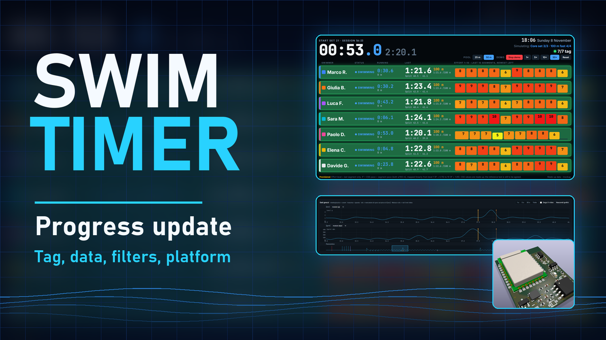](https://youtu.be/JLs5JJG4JG8)

Watch the English version on YouTube: **https://youtu.be/JLs5JJG4JG8**. Italian version: https://youtu.be/_Htx2DawnF8.

A progress update on the project as of 2026-11-08. The soundtrack is original music generated by code. Sources in [`media/video/`](media/video/); the video files are not in the repository.

### First presentation (2 minutes)

[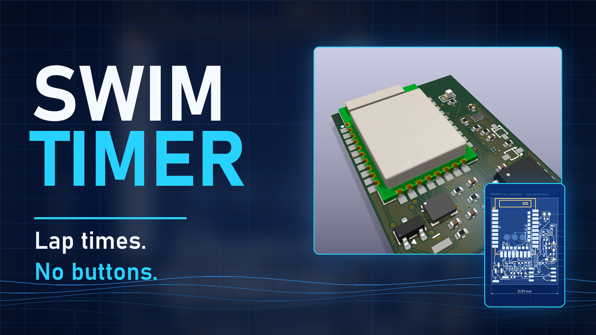](https://youtu.be/EVrdSybpnE4)

English: **https://youtu.be/EVrdSybpnE4**. Italian: https://youtu.be/_2UzpOqblVI.

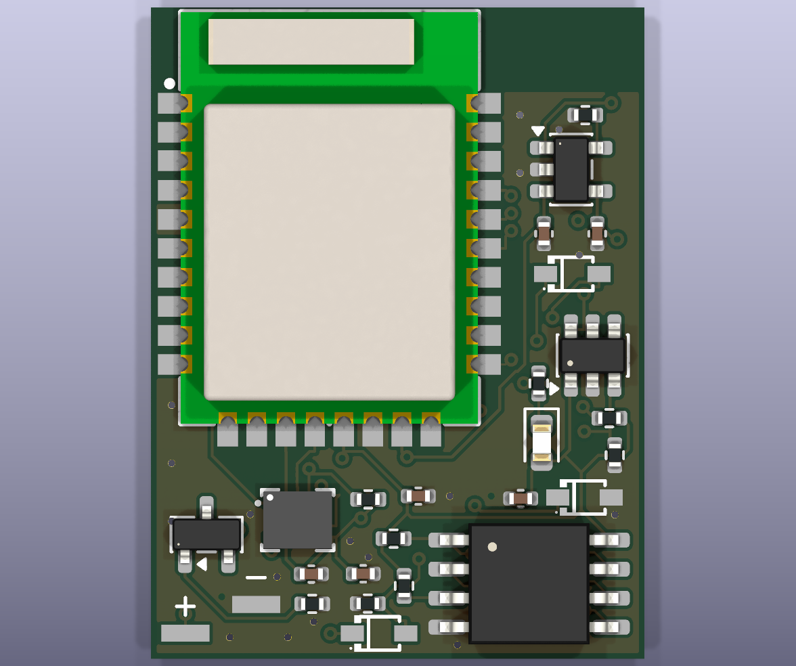

## Table of contents
- [What is SwimTimer](#what-is-swimtimer)
- [Current status](#current-status)
- [Test methodology: raw data, video and hand annotation](#test-methodology-raw-data-video-and-hand-annotation)
- [System architecture](#system-architecture)
- [ESP32 prototype, firmware 0.4.3](#esp32-prototype-firmware-043)
- [nRF52840 tag](#nrf52840-tag)
- [XIAO nRF52840 Sense test tags](#xiao-nrf52840-sense-test-tags)
- [Tag to display synchronization](#tag-to-display-synchronization)
- [Tools page (`tools/index.html`)](#tools-page-toolsindexhtml)
- [Analysis: video (OpenCV) and IMU test bench](#analysis-video-opencv-and-imu-test-bench)
- [Online collaboration app](#online-collaboration-app)
- [External reviews](#external-reviews-v04)
- [Programmer HAT for Raspberry Pi 3/4](#programmer-hat-for-raspberry-pi-34)
- [Poolside display mockup and proposed architecture](#poolside-display-mockup-and-proposed-architecture)
- [Planned features and ideas](#planned-features-and-ideas)
- [Technical wallpaper gallery](#technical-wallpaper-gallery)
- [Repository structure](#repository-structure)
- [How to regenerate the files](#how-to-regenerate-the-files)
- [Ordering flow: JLCPCB and NextPCB](#ordering-flow-jlcpcb-and-nextpcb)
- [Roadmap and open issues](#roadmap-and-open-issues)
- [Privacy and security](#privacy-and-security)
- [License and author](#license-and-author)

## What is SwimTimer

**Problem.** In the pool, lap times and rests get lost. Looking at a watch or pressing a button interrupts the workout.

**Solution.** A small tag with an inertial sensor (accelerometer and gyroscope) is worn under the swim cap. It detects the wall push-off (start), the turns and the stillness at the finish on its own. A poolside display shows the times.

**Physical constraint.** 2.4 GHz BLE does not travel through water. Time is not measured with the radio signal: the sensor on the tag decides. BLE is used only out of the water, to detect proximity to the display and to transfer data. Full feasibility analysis: [`docs/IDEA.md`](docs/IDEA.md) (in Italian).

## Current status

| Area | Status |
|---|---|
| ESP32-S3 + BMI160 prototype, firmware **0.4.3** | Working on the bench; no pool tests yet. Its tools were removed from the tools page on 2026-11-08 |
| LilyGO T-RGB display (4-hand pace clock) | Working on the bench |
| nRF52840 tag **v0.5 "economy"** | Ready: 21.59 x 28.0 mm, 2 layers, DRC 0, ERC 0 errors, `verifica_v05.py` 100/100 pins. JLCPCB files plus NextPCB files (single board and 3x1 / 2x1 panels); JLC placement preview checked, Q1 and U6 rotations fixed (commit `dea9744`) |
| nRF52840 tag **v0.6 "Rev0"** (new) | 4 layers 0.8 mm, 21.59 x 28.5 mm, no BGA (NextPCB Rev0 rejects pitch below 0.45 mm). Files generated; JLC rotations of the new SOT-23 parts still to verify in a JLC preview |
| XIAO nRF52840 Sense test tags | One board in use on the bench ([`hardware/xiao/README.md`](hardware/xiao/README.md)). Firmware 0.5.2 (no automatic sleep on USB power), 0.5.3 (USB during a recording closes it and restarts in normal mode) and 0.5.4 (charge current 100 mA) flashed and checked on the bench; test cell 1000 mAh; pool recording download and recorded data not yet checked; not yet used in the pool |
| XIAO firmware **0.6.0** (`firmware/xiao-stream`) | Ring flash of 512 blocks, `.swr` format 3, BLE always on (also while recording), 2 connections, settable name and colour. Tested in a dry run with the display; the published OTA release is still 0.5.4 |
| Display firmware `firmware/display-sync` | LilyGO T-RGB: receives the blocks from up to 3 tags, verifies, writes to microSD and confirms. Dry run: 2 tags x 15 min, 666 blocks saved and confirmed, 0 CRC errors, 0 anomalies. Signal strength still to be tuned |
| Tools page `tools/index.html` | XIAO only: Live, Recording, Annotation and Firmware tabs, USB / Bluetooth / Demo. Also published on the Firebase site at `/strumenti/`, with an "Upload online" button. Tested in the browser with Demo and simulated ports, not yet with the real XIAO over USB for a full download |
| Online collaboration app | Bilingual (IT/EN) public landing page with a contact form, and members' area (Google login, admin approval of new accounts, admin page for messages). Poolside display section with a live demo. Firestore rules tested with 17 emulator tests. Not yet used with real sessions |
| Test campaign 1 | **Planned**: one swimmer (the author), 50 m pool, wall drills, then a real training session as verification. See [Test methodology](#test-methodology-raw-data-video-and-hand-annotation) |
| Order | **Not placed yet**: preview, finish choice (HASL/ENIG), DFM ticket and cost decision pending |
| nRF52840 tag firmware | To be written (Zephyr / nRF Connect SDK) |
| Programmer HAT for Raspberry Pi 3/4 | Designed, regenerated on v0.5 (TP1-TP7 unchanged), DRC 0; **not built yet** |

## Test methodology: raw data, video and hand annotation

The core of SwimTimer is a set of **filters** that recognise strokes, breaths, turns, starts and finishes from the IMU of a tag worn under the cap. Before writing those filters we need **ground truth**: real swimming data in which every event is known. For this phase the tag is a **Seeed XIAO nRF52840 Sense** (same SoC as the custom board, which is still being manufactured) running the pool recording firmware [`firmware/xiao-stream`](firmware/xiao-stream/) 0.5.x.

**Test campaign 1 (planned).** The first campaign has a deliberately small scope:

- **One swimmer only**: the author of the project. No other person is recorded.
- **Pool**: 50 m, with a wall for the drills.
- **Drills at one wall** (turns, starts, finishes), repeated to collect many examples of each event with known timing.
- **Real training** afterwards, used to verify the filters on a session that was not used to tune them.
- **Video** from an iPhone and an Insta360 camera, both at 30 fps for now (the page does not yet handle 25 fps).
- **Annotation by hand first**, in the *Annotation* tab. Filters are developed and compared **only in the web page**, after the whole session is annotated.

The steps below describe the procedure of each session.

1. **Record raw data in the pool.** The swimmer wakes the tag (2 taps, blue LED, 2 taps): it records the raw accelerometer and gyroscope at 208 Hz to its flash, with BLE off (BLE does not cross water). The swimmer is filmed from the deck with a phone (H.264, 30 fps).
2. **Sync gesture.** With the tag under the cap, the swimmer gives **5 large, clearly visible taps** on it. The taps are sharp peaks in the data and visible frames in the video: the **5th tap** is the common reference point.
3. **Swim 5-10 minutes,** then put the tag in the bag: after 180 s of rest it closes the recording and sleeps. The data survives even if the battery runs out on the way home.
4. **Download at home over USB** from the *Recording* tab of [`tools/index.html`](tools/index.html) (Web Serial) or with [`scarica.py`](firmware/xiao-stream/scarica.py): a `.swr` file.
5. **Align video and data** in the *Annotation* tab: press **X** on the video frame of the 5th tap and click the 5th peak in the zoomable raw-data chart. The page computes the offset; from then on the data follow the video, forwards and backwards.
6. **Annotate events by hand** while watching the video (slow motion, frame by frame): **B** stroke (hand entry), **R** breath (mouth out of the water), **V** turn start, **F** turn end, **P** start, **A** arrival. Events are stored in video time, so a later offset correction moves them all at once; they are saved as a project JSON and a CSV.
7. **Develop the filters** on the raw data, re-process the same recording and **compare** the automatic events with the hand-annotated ones (matches within a time tolerance, precision, recall, timing error). This happens only after the whole session has been annotated.

Recordings, videos and annotation projects are health data: they stay on the PC and are excluded from git; the repository only contains code and invented test data.

## System architecture

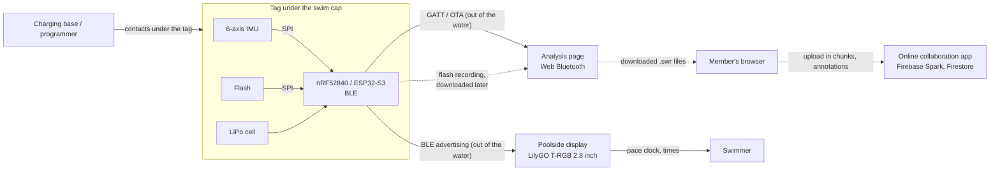

- **Synchronization.** After the swim the tag pushes its recorded blocks to the poolside display over BLE; the display verifies, stores and confirms them. See [Tag to display synchronization](#tag-to-display-synchronization).
- **Tag.** Under the cap, pressed against the skull. It decides START, turns and STOP on its own using the IMU and logs raw data to flash.
- **Poolside display.** Receives the tag's BLE advertisements without connecting. Shows a 4-hand pace clock. Goes to sleep after 5 minutes without a tag.
- **Tools page.** [`tools/index.html`](tools/index.html) connects to the XIAO over USB or Bluetooth, downloads and annotates recordings and updates the firmware. Details in [Tools page](#tools-page-toolsindexhtml).
- **Online app.** Optional collaboration area for sessions, video links and annotations. Details in [Online collaboration app](#online-collaboration-app).
- **BLE out of the water.** Underwater the signal disappears within a few centimetres: during the swim the tag works alone and hands over its data when the swimmer emerges or at the end of the session.

## ESP32 prototype, firmware 0.4.3

The prototype was used to tune the algorithms before the XIAO and custom boards. Since 2026-11-08 the tools page no longer supports it.

**Tag (prototype).** ESP32-S3 SuperMini + BMI160 (GY-BMI160), LiPo with main switch. Bill of materials: [`hardware/bom.md`](hardware/bom.md). Wiring: [`hardware/schema.md`](hardware/schema.md) (both in Italian).

**Firmware 0.4.3** (`firmware/test-collegamenti`, arduino-cli, core `esp32:esp32` 3.3.12):
- +/-16 g and 100 Hz, set with the sensors on and read back (up to 5 attempts);
- flash with two program copies and about 1.9 MB of LittleFS (about 40 minutes at 50 Hz);
- double tap = start recording, triple tap = stop (software detection, unreliable: about 1 in 10);
- BLE with data, status, commands, OTA and version; the same commands over USB; Bluetooth update with automatic rollback to the previous version;
- automatic I2C bus recovery, RGB LED feedback, last reset reason, voltage dividers on GPIO 1 (battery) and GPIO 2 (5V pin).

**Display** (`firmware/display-prova`): LilyGO T-RGB 2.8 inch, PlatformIO with espressif32 6.9.0, driver copied and adapted in `src/trgb/` (MIT license, Xinyuan-LilyGO).

**Build and upload the tag firmware:**
```
arduino-cli compile --fqbn esp32:esp32:esp32s3:CDCOnBoot=cdc --upload -p <COM> firmware/test-collegamenti
```

Related documents (in Italian): [`docs/RICERCA-ALGORITMI.md`](docs/RICERCA-ALGORITMI.md) (algorithm research), [`docs/LEZIONI-APPRESE.md`](docs/LEZIONI-APPRESE.md) (13 prototype lessons for the miniaturised board), [`docs/REQUISITI.md`](docs/REQUISITI.md) (requirements), [`docs/DESIGN.md`](docs/DESIGN.md) (design).

## nRF52840 tag

**Goal.** Replace the prototype with a miniature tag for the swim cap, assembled by the fab, with contact charging and programming through pads on the underside. Design document: [`hardware/nrf52840/progetto.md`](hardware/nrf52840/progetto.md) (Italian).

### Version history

| Version | Date | Board | Content | Outcome |
|---|---|---|---|---|
| v0.1 | 2026-10-25 | 17.5 x 20.5 mm, 4 layers | Raytac MDBT50Q, LSM6DSV16X, MS5837, 32 MB flash, BQ25101, vibration motor | Superseded |
| v0.2 | 2026-10-25 | 17.5 x 22.5 mm, 4 layers | Added TVS, Schottky and reset on insertion into the case; DRC 0 | Historical |
| v0.3 test (1c) | 2026-11-01 | 26 x 30 mm, 4 layers 0.8 mm | Ebyte E73 (Raytac out of stock), TPS22916C, MAX17048, Ampul 401012 cell on JST SH, Tag-Connect, test pads; motor not fitted; DRC 0, 609 tracks, 80 vias | Ready, never ordered (~120-130 USD) |
| v0.4 economy | 2026-11-02 | 22.86 x 26 mm, 2 layers | IMU recording only, budget <= 100 EUR: removed pressure sensor, MAX17048, TPS22916C, motor, Tag-Connect, TVS; 16 MB flash | Compacted |
| v0.4 compacted | 2026-11-03 | **21.59 x 26 mm**, 2 layers | 0603 *basic* LED with anode on VDD, pinout changed, DRC 0, JLC files regenerated | Verified (65 tests, 0 blocking) |
| v0.5 economy | 2026-11-04 | **21.59 x 28.0 mm**, 2 layers | TPS22916C on VDD_IMU, TVS, AO3401A against reversed cell, 100 kOhm VIN-GND, TP8, IMU_MISO/CS on P0.08/P0.12; DRC 0, ERC 0 | **Ready**, not ordered; 2026-11-05: Q1 and U6 rotations fixed after the JLC preview (`dea9744`) |
| v0.6 "Rev0" | 2026-11-06 | **21.59 x 28.5 mm**, 4 layers 0.8 mm | No BGA: MCP73831 (SOT-23-5) instead of BQ25101, TPS22917 (SOT-23-6) instead of TPS22916C; J1 not assembled | **Files generated**, JLC rotations to verify |

### v0.6 "Rev0" (new)

Project `kicad/swimtag_v06.*` (`.kicad_sch`, `.kicad_pcb`, `.kicad_pro`), data in `kicad/dati_v06.py`, positions in `kicad/posizioni_v06.py`. v0.5 stays unchanged.

**Why.** The NextPCB Rev0 service rejects BGA parts with pitch below 0.45 mm (the BQ25101 DSBGA is 0.4 mm). v0.6 removes all BGA parts.

| Change vs v0.5 | Detail |
|---|---|
| Charger | **MCP73831T-2ACI/OT** (SOT-23-5) replaces the BQ25101; PROG 66.5 kOhm = **15 mA**; STAT drives CHG_N through a 1N4148WS (D4) with a 100 kOhm pull-up |
| Load switch | **TPS22917DBVR** (SOT-23-6) replaces the TPS22916C (U6), still on VDD_IMU with ON on P0.04 |
| Stack-up | **4 layers, 0.8 mm**, In1 = ground plane |
| Size | **21.59 x 28.5 mm** |
| J1 | Not assembled (DNP): the battery wires are soldered by hand to the J1 pads |

**Files.**
- Gerber, BOM and CPL for JLCPCB: `hardware/nrf52840/kicad/jlc/v0.6_swimtag_v06/` (also `schema.pdf` and renders).
- NextPCB: `hardware/nrf52840/kicad/nextpcb/v0.6/` (`bom_nextpcb.csv/.xlsx`, `cpl_nextpcb.csv`, `centroid_nextpcb.xlsx/.zip`, `swimtag_gerber.zip`, `assembly_top_render.png`, `assembly_pin1.png` with the pin-1 markers).
- Verification script: `kicad/verifica_v06.py`; assembly drawing: `kicad/disegno_montaggio_v06.py`.

**Still to do.** Check in a JLC preview the rotations of the new SOT-23 parts (MCP73831, TPS22917, D4), then order.

### NextPCB files for v0.5

NextPCB is the alternative to JLCPCB for the v0.5 board (2 layers). Files in `hardware/nrf52840/kicad/nextpcb/`:

| Folder | Content |
|---|---|
| `v0.5/` | Single board: Gerber zip, BOM, CPL, centroid, assembly render |
| `v0.5_pannello_3x1/` | 3 x 1 panel: `pannello_3x1.kicad_pcb`, Gerber, BOM, CPL, DRC report |
| `v0.5_pannello_2x1/` | 2 x 1 panel: same files |

Panels use **mouse bites** (no V-cut). **J1 is not assembled**: the user solders the battery wires to the J1 pads. Panels are built with `kicad/crea_pannelli.py`; the NextPCB export is `kicad/esporta_nextpcb.py`.

### v0.5 in detail

v0.5 derives from v0.4 with the changes decided after the [external reviews](#external-reviews-v04). Read first the "Revisione v0.5" block in [`hardware/nrf52840/progetto.md`](hardware/nrf52840/progetto.md). v0.4 is **historical**: frozen files in `kicad/jlc/v0.4_swimtag_economica/`, regenerable from commit `8fd6cc0`.

**Dimensions.** **21.59 x 28.0 mm**, 2 layers, 0.8 mm, 25 components per board, 369 tracks, 36 vias. At 26-27.5 mm the 2-layer routing does not complete (0.4 mm BGA of the BQ25101 and the IMU MISO line). Finished tag about 25 x 31 mm with resin.

**Changes vs v0.4:**

| Ref. | Change | LCSC | JLC type |
|---|---|---|---|
| U6 | TPS22916C: VDD -> VDD_IMU for the IMU, ON on P0.04 (`SENS_ON`) with R7 1 MOhm; R6 (CS pull-up) on VDD_IMU | C2680319 | extended |
| C5 | 4.7 uF 10 V at the BQ25101 input (was 10 uF 6.3 V) | C23733 | basic |
| C6, C7 | C6 4.7 uF 10 V on VBAT, C7 removed | C23733 | basic |
| R8 | 100 kOhm between VIN and GND: no electrolysis between the contacts in water | C25741 | basic |
| D3 | Bidirectional TVS PTVSLC3D5VB on the VIN contact, before D2 | C41408025 | extended |
| Q1, R9 | AO3401A against reversed cell, gate to GND with 100 kOhm | C15127 | basic |
| TP8 | `VDD_IMU` pad, 0.8 mm dia., underside, at (17.78; 12.70) mm | copper only | |

Other changes: IMU_MISO on P0.08 (pad 16) and IMU_CS on P0.12 (pad 20), so XL1/XL2 stay free; 1.0 mm silkscreen; track-free zone on F.Cu at the centre under the module. Pads TP1-TP7 keep the v0.4 coordinates: the programmer HAT remains valid. To test on the bench: Q1 with the cell connected correctly and reversed.

**Checks.** DRC 0 errors and 0 warnings, 0 unconnected, schematic/PCB parity 0, ERC 0 errors (41 harmless `pin_to_pin` warnings from the generated symbols), 28 nets, `kicad/verifica_v05.py`: 100 expected pins out of 100, 0 differences.

**v0.5 pinout changes** (the rest is as in the v0.4 table below):

| E73 pad | GPIO | Net |
|---|---|---|
| 16 | P0.08 | IMU_MISO |
| 20 | P0.12 | IMU_CS (R6 100 kOhm to VDD_IMU) |
| 18 | P0.04 | SENS_ON (R7 1 MOhm to GND) |

P0.00/P0.01 (XL1/XL2) are free; LFCLK stays on the RC oscillator.

#### v0.5 costs
Estimate from the real JLC cart of 2026-11-03 (v0.4, 128.46 EUR), recomputed and not rebuilt in the cart. Standard PCBA assembly is mandatory (E73, IMU, BQ25101). **About 125 EUR with X-ray and coupons, above the 100 EUR cap** (ENIG: +5-10 EUR).

| Cut (cumulative) | Estimated total |
|---|---|
| None (full v0.5, X-ray, coupon) | ~125 EUR |
| No X-ray (risk on unverified BGA/LGA) | ~109 EUR |
| + no TVS D3 | ~105 EUR |
| + no J1 header (wires on pads) | ~100.5 EUR |

All of these give up protection or checks: the user decides. Cell, programmer and pogo pins are excluded.

**Check in the JLC preview:** rotations of U6, Q1, D1, D3, J1 (and U2, U4, D2); the TPS22916C is probably "Standard only". Q1 and U6 were already corrected on 2026-11-05 (`dea9744`).

### v0.4 in detail (historical)

**Purpose.** Two prototypes to record raw IMU data and tune the filters, at minimum cost. Data in `kicad/dati_economica.py`, positions in `kicad/posizioni_economica.py`, dimensioned drawing in [`hardware/nrf52840/ingombro_v0.4.svg`](hardware/nrf52840/ingombro_v0.4.svg).

**Dimensions.** Board **21.59 x 26.0 mm** (8.5 pitches of 2.54 mm), **2 layers**, 0.8 mm, components on top only, 313 tracks, 29 vias. Finished tag about 25 x 29 mm with 1.5 mm of resin. At 20.32 mm the 2-layer routing does not complete (about 100 Freerouting runs, never DRC 0).

**Components (LCSC codes):**

| Function | Component | LCSC | JLC type |
|---|---|---|---|
| Microcontroller and BLE | Ebyte E73-2G4M08S1C (nRF52840), VDDH from the cell, REGOUT0 at 3.3 V from UICR | C356849 | extended |
| 6-axis IMU | ST LSM6DSV16X, SPI with INT1/INT2 | C5267406 | extended |
| 16 MB flash | Winbond W25Q128JVSIQ, SOIC-8, plain SPI | C97521 | basic |
| Charger | TI BQ25101 (TS 10 kOhm to ground, ISET 10 kOhm = 13.5 mA) | C478468 | extended |
| LED | KT-0603R red, anode on VDD | C2286 | basic |
| Charge protection | 1N5819WS Schottky in series with the contacts | C191023 | basic |
| Cell | 1.27 mm 1 x 2 SMD header (wires soldered to the cell) | C55213900 | extended |
| Passives | 6 resistors, 7 capacitors | see `bom_jlc.csv` | basic |

Full bill of materials and rotations: `hardware/nrf52840/kicad/jlc/v0.4_swimtag_economica/` (`bom_jlc.csv`, `cpl_jlc.csv`). Other alternatives considered (WSON flash, JST SH, NTC): [`hardware/nrf52840/progetto.md`](hardware/nrf52840/progetto.md).

**Underside, 2.54 mm grid** (perfboard and pogo pins):

| Pad | Net | x (mm) | y (mm) | Dia. |
|---|---|---|---|---|
| TP1 | VDD (reference only) | 5.08 | 12.70 | 2.0 |
| TP2 | SWDIO | 7.62 | 12.70 | 2.0 |
| TP3 | SWDCLK | 10.16 | 12.70 | 2.0 |
| TP4 | RESET | 12.70 | 12.70 | 2.0 |
| TP5 | GND | 15.24 | 12.70 | 2.0 |
| TP6 | VIN (charge) | 7.62 | 17.78 | 2.5 |
| TP7 | GND (charge) | 12.70 | 17.78 | 2.5 |

Coordinates from the top-left corner (antenna side), board seen from above. Silkscreen ticks every 2.54 mm on the left and top edges.

**Pinout for the firmware** (all signals at 3.3 V after REGOUT0). Full table in [`hardware/nrf52840/verifica_v0.4.md`](hardware/nrf52840/verifica_v0.4.md), section 3 (Italian).

| E73 pad | GPIO | Net | Notes |
|---|---|---|---|
| 11 | P0.00 | IMU_CS | R6 100 kOhm to VDD; pin XL1: **LFCLK not from XTAL** |
| 13 | P0.01 | IMU_MISO | pin XL2 |
| 15 | P0.05 | IMU_MOSI | |
| 17 | P1.09 | IMU_SCK | SPI up to 8 MHz |
| 12 | P0.26 | IMU_INT1 | |
| 14 | P0.06 | IMU_INT2 | |
| 30 | P0.17 | FL_CS | R5 100 kOhm to VDD |
| 28 | P0.15 | FL_MISO | |
| 33 | P0.13 | FL_MOSI | |
| 35 | P0.24 | FL_SCK | /WP and /HOLD high: plain SPI only |
| 32 | P0.20 | CHG_N | internal pull-up; low = charging |
| 34 | P0.22 | LED | active low, about 1.4 mA |
| 26 | P0.18 | RESET | after writing `UICR.PSELRESET` |
| 37 / 39 | SWDIO / SWDCLK | SWD | pogo TP2 / TP3 |
| 23 | VDDH | VBAT | battery with SAADC channel `VDDHDIV5`, no divider |

This is the v0.4 pinout: in v0.5 IMU_CS and IMU_MISO change and SENS_ON is added (see above). UICR registers to write once over SWD: `REGOUT0` (0x10001304) = `0xFFFFFFFD` (3.3 V), `PSELRESET[0]` and `[1]` (0x10001200 / 0x10001204) = `0x12`.

**Main choices.**
- **16 MB flash** SOIC-8 *basic*: 4.93 USD for 2 boards versus 9.83 USD for the WSON. Duration: about 24 minutes at 960 Hz (six axes, 16 bit), about 97 minutes at 240 Hz, about 3 hours at 120 Hz.
- **0603 *basic* LED** with anode on VDD: saves 3.07 USD of extended loading fee and injects no current into the pin at first power-up (VDD at 1.8 V with empty UICR).
- **1.27 mm SMD header** instead of JST SH: 10.4 vs 26.6 mm², cheaper.
- **2 layers, lead-free HASL**: routing completes without touching the antenna zone (3.7 mm without copper).
- **Removed:** pressure sensor (no depth available), MAX17048, motor, Tag-Connect, TVS, reset on insertion.

**Real costs from the v0.4 JLC cart** (2026-11-03, 22.86 x 26 mm board, before the *basic* LED and the TPS22916C). E73, IMU (LGA) and BQ25101 (BGA) can be assembled **only with Standard PCBA**, not Economic:

| Item | EUR |
|---|---|
| 5 PCBs 2 layers HASL (offer) | 1.79 |
| Standard setup | 23.02 |
| Stencil | 7.39 |
| Components for 2 boards | 26.95 |
| Extended loading (5 types) | 16.63 |
| SMT assembly | 0.66 |
| X-ray | 8.85 |
| Packaging | 0.45 |
| Shipping | 9.62 |
| VAT, temporary duty and EU handling fees | 31.32 |
| **Total** | **128.46** |

Reductions: *PCBA Special Offer* coupon (-8.05 EUR, expires 2026-11-29) and *JLCONE PCB* (up to -1.79 EUR), *basic* LED already done (about -4 EUR with VAT). The TPS22916C adds one extended loading fee (about +4.5 EUR with VAT). For v0.5 see [v0.5 costs](#v05-costs).

### Independent verification (v0.4)

Document: [`hardware/nrf52840/verifica_v0.4.md`](hardware/nrf52840/verifica_v0.4.md) (Italian). Carried out on 2026-11-03 by a reviewer agent on commit `8fd6cc0`, with `kicad-cli` 10.0.6 and the script `kicad/verifica_v04.py` (expected table written by hand from the datasheets).

**Result: 65 tests, 0 blocking defects.** Netlist: 85 expected pins, 0 differences; PCB and schematic match; pinouts and footprints consistent with the datasheets.

Main warnings:
- **HASL or ENIG finish.** HASL with the 0.4 mm BGA of the BQ25101 is discouraged by JLC; the review recommends ENIG (costs more). The user chooses at order time.
- **IMU LGA (U2):** orientation to confirm in the JLC preview and pad dimensions to compare with the DS13510 mechanical drawing (not reached).
- **Polarity of LED (D1), Schottky (D2) and header (J1)** and rotations of E73, IMU, BQ25101: confirm in the JLC preview. The header is symmetric: no reverse-cell protection (mark the wires).
- **Voltage margin:** VDD follows VDDH - 0.3 V below 3.6 V and the flash needs at least 2.7 V: battery cut-off in firmware at 3.2-3.3 V.
- **External current from VDD:** 5 mA with radio above +4 dBm: do not write to flash while BLE transmits at high power.
- **Charger:** C5 rated >= 10 V, consider removing C6 or C7; with a 5.0 V input and the Schottky the margin on VIN-DPM is narrow; load during charging prevents termination (10 h timer).
- **Antenna:** the Ebyte datasheet does not dimension the keep-out zone; a range test before the resin is mandatory.
- **Firmware:** no DC/DC, LFCLK from the RC oscillator (P0.00/P0.01 used as GPIO), no USB events.
- **TPS22916C:** applied in v0.5. Firmware: SPI, CS and INT low before removing power and a 5-10 ms wait at power-up. The v0.5 check is `kicad/verifica_v05.py` (100/100 pins).

### Related documents
- [`hardware/nrf52840/bom.md`](hardware/nrf52840/bom.md): bill of materials with LCSC codes and alternatives (Italian).
- [`hardware/nrf52840/verifiche.md`](hardware/nrf52840/verifiche.md): datasheet checks (v0.2/v0.3, Italian).
- [`hardware/nrf52840/SwimTag_v0.3_collaudo.pdf`](hardware/nrf52840/SwimTag_v0.3_collaudo.pdf): historical v0.3 PDF.
- Renders: `hardware/nrf52840/kicad/jlc/v0.6_swimtag_v06/render_sopra.png`, `render_sotto.png`, `render_3d.png` (v0.5 in `v0.5_swimtag_economica/`, v0.4 in `v0.4_swimtag_economica/`).
- [`hardware/nrf52840/saldatura_cella_v0.5.png`](hardware/nrf52840/saldatura_cella_v0.5.png): where to solder the cell wires.
- [`hardware/nrf52840/revisioni_esterne.md`](hardware/nrf52840/revisioni_esterne.md): outcome of the Gemini and Copilot reviews (Italian).

## XIAO nRF52840 Sense test tags

A cheap path to test now, while the custom boards are in the making: two **Seeed XIAO nRF52840 Sense** boards (same SoC, Arduino firmware for now), worn under the cap. They record the raw IMU to flash while in the water (BLE off) and the data is downloaded over USB at home. Full bill of materials, procedures, risks and sources (Italian): [`hardware/xiao/README.md`](hardware/xiao/README.md).

- **Board.** XIAO nRF52840 Sense (LSM6DS3TR-C IMU on I2C, 2 MB QSPI flash, TI BQ25101 charger), about 16 EUR each with VAT.
- **Cell.** For the tests the tag now uses a **1000 mAh** LiPo cell. The first choice was the **LP-401230, 100 mAh** with protection (30.5 x 12.0 x 4.05 mm). The 40 mAh cell used on the custom boards is **unsuitable**: the XIAO charger delivers at least 50 mA, i.e. 1.25 C on 40 mAh.
- **Charge time.** At the 100 mA charge current (0.1 C on 1000 mAh), an empty 1000 mAh cell needs about 10-12 h. The voltage rises slowly (3.58 V to 3.61 V in about 2 h), so a flat reading early in the charge is expected. The tools page estimates the time to full with 1000 mAh and 100 mA.
- **IMU power.** The IMU is powered from pin P1.08 (IMU_PWR): the firmware power-cycles it to clear a latch-up and switches it off during sleep.
- **Waterproofing for tests.** Vacuum bag for the first tests; potting (epoxy) is evaluated in the document and requires a dry run on a dummy sample first.
- **Soldering.** Only the two cell wires to the BAT pads on the back.

### XIAO firmware (`firmware/xiao-stream`): BLE streaming 0.4.2 and pool recording mode 0.5.x

Arduino sketch (core Seeeduino:nrf52 + Bluefruit) that makes the XIAO speak the same **`SwimTag` BLE protocol** as the ESP32 tag, so the [tools page](#tools-page-toolsindexhtml) connects to it over Web Bluetooth or USB. Details (Italian): [`firmware/xiao-stream/LEGGIMI.md`](firmware/xiao-stream/LEGGIMI.md).

- **Data.** 16-byte packets at 25 Hz; the IMU runs at 208 Hz and is averaged down. Gyroscope bias calibration reduces head drift.
- **Status.** 12-byte extended status: charge state, VBUS, die temperature, battery divider. Commands, tag log and version are as on the ESP32 tag. The page has a "Tag log" panel over BLE and a rebuilt Battery panel (charge state, % from a LiPo curve, time to full / runtime, chart, VCAL calibration against a multimeter).
- **OTA over BLE.** Own protocol on characteristic `0006`: staging in flash, CRC32, board signature check, installer running from RAM. Nordic legacy DFU cannot be used from the browser because it is on the Web Bluetooth blocklist. The binary `firmware/xiao-stream/release/xiao.bin` + `xiao.json` is published by GitHub Pages (workflow updated); the "Tag firmware" dialog of the page handles the XIAO too. The release binary is built with `-fmacro-prefix-map` so that no local build paths (e.g. the Windows user folder) end up inside it; the published `xiao.bin` is **0.5.4** (BLE streaming + OTA, pool recording, 100 mA charge), 155,684 bytes, CRC32 `b771d198`.
- **Sleep.** "Sleep" command, and automatic sleep after 60 s of "still enough" (1 s averages: rotation < 3 dps and tilt < 3 deg). Never during an OTA or with the serial port open. Wake with 2 taps, blue LED, 2 taps (or by USB). Forced sleep when the battery is low (< 3.3 V).
- **0.5.2: no sleep on USB power.** While VBUS is present the tag does not go to automatic sleep, even with no serial port open. Before, it slept after 60 s on the desk and disappeared from USB.
- **0.5.3: USB during a recording.** Plugging USB in during a pool recording closes it cleanly (new stop reason 4, "USB connected", also decoded by `swr.py` and `tools/swr.js`) and restarts the tag in normal mode, so it can be read from the tools page. Before, the recording loop ignored serial commands and the page reported "MEM does not respond".
- **0.5.4: charge current 100 mA.** The BQ25101 charge current is raised from 50 mA to 100 mA (P0.13 driven low, kept in System OFF). Reason: the test board has a dead 3.3 V regulator and is powered from the cell through a diode; at 50 mA its voltage stayed at 3.57 V while charging. Flashed over BLE from the PC with a script that uses the OTA protocol of the page; the version is verified as `xiao-0.5.4`.
- **Verification status.** Tested on the board: double tap, OTA (0.4.0 -> 0.4.1 -> 0.4.2) and sleep. 0.5.2 flashed over USB: still on the port after 80 s at rest. 0.5.3 flashed and checked with the memory command (`K mem 2204 8192`). 0.5.4 flashed over BLE and version checked; charging at 100 mA is under observation (see the cell notes above). **Not yet tested:** 4-tap wake, low-battery sleep, the Battery panel with the board, VCAL calibration, a full charge at 100 mA.
- **Bench note.** One XIAO lost its 3.3 V regulator while the cell was being soldered; it is used on the bench through a silicon diode. Heat the BAT pads briefly and with care.

#### Firmware 0.6.0: ring flash, BLE always on, synchronization

Source in [`firmware/xiao-stream`](firmware/xiao-stream/); the published release `release/xiao.bin` is **still 0.5.4** (0.6.0 is not yet published for OTA).

- **Ring flash.** The 2 MB flash is a ring of **512 blocks of 4 KB**. A block is overwritten only after the display has confirmed it. Recording stops when the memory is full of unconfirmed blocks. A memory that is not recognised is never erased automatically.
- **`.swr` format 3.** Each block has a header (marker `0xB1`) with a global sequence number that is never reused, even after an erase. The confirmation flag is stored in the last word of the block (bytes 252..255): the Puya flash replaces a 4-byte word instead of ANDing it, so format 2 (confirmation in byte 16) corrupted the sequence number. Found and fixed with no data lost. Decoders [`swr.py`](firmware/xiao-stream/swr.py) and [`tools/swr.js`](tools/swr.js) read formats 1, 2 and 3.
- **BLE always on.** Also while recording: 200 ms advertising with state, battery, memory and colour; up to 2 connections.
- **Settings.** Tag name (up to 11 characters) and colour (palette of 10) can be set from the tools page. LEDs are off on battery.
- **Sync service** `7a1e0101`: see [Tag to display synchronization](#tag-to-display-synchronization).

#### Pool recording mode (firmware 0.5.0 to 0.5.4)

BLE does not cross water, so for the first pool session the tag records the **raw IMU to its 2 MB QSPI flash** with BLE off, and the data is downloaded at home over USB. Purpose: collect real swimming data with video, hand-annotate every event, then develop and compare the detection filters. Details (Italian): [`firmware/xiao-stream/LEGGIMI.md`](firmware/xiao-stream/LEGGIMI.md).

**Usage.**
- **Normal mode:** blue LED blinking every 0.5 s (BLE advertising). This is the state whenever USB is connected or after a reset.
- **To record:** unplug USB, put the tag to sleep ("Sospendi" (Sleep) button, or 60 s still), then 2 taps → solid blue → 2 taps → 3 green blinks. After that, one green blink every 8 s while recording.

- **Start recording.** 2 taps, blue LED, 2 taps (from 0.5.1 the LED blinks off at each counted tap). Without USB the tag starts recording at once; if the memory already holds a recording, a new segment is appended (one session, several wake-ups). With USB connected the taps give the normal mode (BLE, OTA, log) and nothing is recorded.
- **Erase.** 2 taps, blue LED, 6 taps, then 2 confirmation taps within 4 s (flashing red LED). Without confirmation nothing happens.
- **Stop.** No tap-based stop. The tag stops after 180 s of rest, when the memory is full or when the battery drops below 3.3 V, then goes to sleep.
- **Recorded data.** 208 Hz, accelerometer +-16 g, gyroscope +-1000 dps, about 25 minutes of capacity thanks to int8 delta compression. The gyroscope bias is not corrected (it is estimated at home from still segments). LED signals are listed in the firmware document.
- **Robustness.** 256-byte pages written once, each with a CRC16 and decodable on its own; data survives battery loss (a segment without closing page is reported as such).
- **Wake-up fix.** The 2-tap wake bug was caused by the Adafruit bootloader clearing `RESETREAS`; the firmware now writes a marker in `GPREGRET2` before every System OFF.
- **Download over USB only.** [`scarica.py`](firmware/xiao-stream/scarica.py) (needs `pyserial`) or the "Recording" tab of the page (Web Serial). Output: a `.swr` file plus CSV.
- **`.swr` format.** Specified in [`swr_formato.h`](firmware/xiao-stream/swr_formato.h); decoders [`swr.py`](firmware/xiao-stream/swr.py) and [`tools/swr.js`](tools/swr.js). 11 unit tests on invented data only (`python -m unittest test_swr`). The parity check [`tools/parita_swr.mjs`](tools/parita_swr.mjs) still has to be run on a real recording.
- **Web page.** [`tools/index.html`](tools/index.html) has the *Recording* tab (Web Serial download and erase, open a `.swr` file) and the *Annotation* tab (raw-data charts with zoom, video with the real frame rate measured while playing (frame steps; a clicked event is moved with the left/right arrow keys, Shift for 10 frames, Esc to release; warns if the video has no decodable picture, e.g. HEVC), synchronisation with key X on the 5th tap, events B/R/V/F/P/A saved in video time, project JSON and CSV export). See [Tools page](#tools-page-toolsindexhtml).
- **Verification status.** 0.5.0 is flashed on the board: the 2-taps-blue-2-taps wake-up and the start of recording (green blink every 8 s) are confirmed; the download and the recorded data are **not yet checked**: FIFO order and burst reads, chip erase, QSPI without SoftDevice and power consumption (estimated 1.5-2 mA while recording) are unverified. 0.5.1 is superseded by 0.5.2, 0.5.3 and 0.5.4 (see above). The C++ encoder has never been run on a PC: C++/Python parity holds by construction only. The page tabs were tested with simulated data only. `.swr` files and CSV are health data and are ignored by git.
- **Next steps.** Dry run of 0.5.0 at home, first pool session with video, hand annotation of all events, then filter development and comparison.

## Tag to display synchronization

Protocol specification (Italian): [`docs/SINCRONIZZAZIONE.md`](docs/SINCRONIZZAZIONE.md). It moves the recorded data from the tags to the poolside display without the swimmer doing anything, and without ever losing a block.

**Flow.**

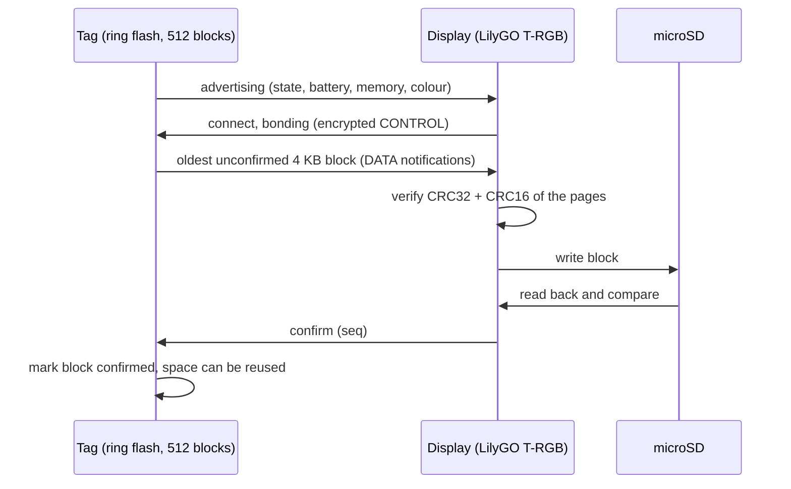

**Rules.**
- **4 KB blocks.** The tag sends the oldest unconfirmed block; window of 2 blocks.
- **Services.** BLE service `7a1e0101`: CONTROL characteristic (encrypted, with bonding), DATA (notifications), SYNC STATE (151 bytes).
- **Verification.** The display checks CRC32 of the block and CRC16 of each page, writes it to microSD, reads it back and only then confirms.
- **No timed resend.** The tag never resends on a timer.
- **Global sequence number** never reused, also after an erase.
- **Invariant.** The tag never overwrites an unconfirmed block; when memory is full of unconfirmed blocks, recording stops.

**Display firmware** [`firmware/display-sync`](firmware/display-sync/) (PlatformIO, espressif32 6.9.0, Adafruit GFX, no LVGL; details in [`LEGGIMI.md`](firmware/display-sync/LEGGIMI.md), Italian):
- Dial in **3 sectors of 120 degrees**, one per tag, with the **map of the 512 blocks** (validated / transmitting / to validate / open / free), tag name and colour, battery (LiPo curve) and signal in %.
- Up to **3 tags connected at once**; a single task writes to the SD card; the display never goes to standby; a boot log is kept on the SD card.
- **DEMO mode** with 3 simulated tags.

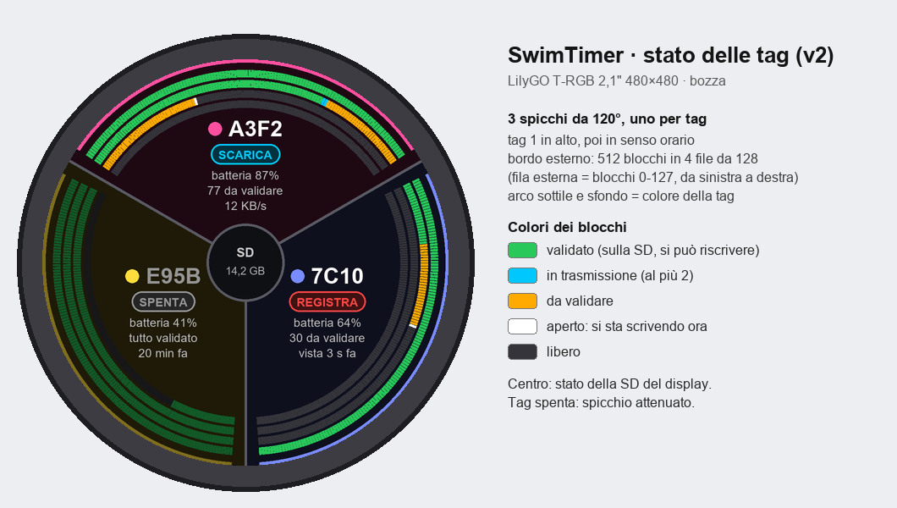

**Dry run (2026-11-10).** 2 tags x 15 minutes next to the display: **666 blocks saved and confirmed, 0 CRC errors, 0 anomalies**, memory of both tags working as a ring, no display restart. Measured throughput up to 8 KB/s against 1.25 KB/s produced at 208 Hz. Signal on the T-RGB is weak (about -57 / -64 dBm at 10 cm) and still to be tuned.

**Tools page.** The *Synchronization* panel shows the state and the block map and sets name and colour; the `.swr` reader opens formats 1, 2 and 3 (test [`tools/test_swr2.mjs`](tools/test_swr2.mjs)). Use Edge: on Windows Chrome keeps a stale BLE connection.

## Tools page (`tools/index.html`)

Static page (no build step) for the XIAO test tags. It also has a *Synchronization* panel (see [Tag to display synchronization](#tag-to-display-synchronization)); Edge is recommended for Bluetooth. Online at <https://pzero.github.io/SwimTimer/>, or open the file locally in a browser. The same page is published on the Firebase site at <https://swimtimer-pzero.web.app/strumenti/> (copied at deploy by `firebase/prepara-strumenti.mjs`). On GitHub Pages the **Upload online** button points to the Firebase site; on the Firebase copy it uploads the `.swr` file to the shared archive of the online app (members only). Since 2026-11-08 it supports only the XIAO; the ESP32 tabs, the ESP32 USB link, the radar, the event log and `tools/assi.html` were removed.

**Connection panel (one for all tabs).**
- **USB** (Web Serial, Chromium-based browsers): the port is filtered on the Seeed Studio vendor ID `0x2886`.
- **Bluetooth** (Web Bluetooth, `SwimTag` service).
- **Demo**: simulated data, no hardware.

The panel shows link state, firmware version and battery level. The Recording tab uses the same USB port; USB log lines go to the live log.

**Tabs** (the labels in the page are in Italian: *Dal vivo*, *Registrazione*, *Annotazione*, *Firmware*):
- **Live**: 3D orientation of the tag from the IMU, battery card, head-mounting calibration (*Calibra*, *Ricentra*), charts of the accelerometer and gyroscope. The head model is the Lee Perry-Smith 3D scan (Infinite-Realities), licensed CC BY 3.0, loaded from a public CDN.
- **Recording**: download and erase the pool recordings over USB, open a `.swr` file, see the decoded data.
- **Annotation**: raw-data charts with zoom, video playback, synchronisation on the 5th tap (key **X**), hand annotation of events **B**, **R**, **V**, **F**, **P**, **A**, export of a project JSON and an events CSV. Known limits: 30 fps only; phone video in HEVC/H.265 may play audio only, depending on the browser; the page warns about it.
- **Firmware**: update over Bluetooth with the XIAO OTA protocol. Only XIAO-signed images are accepted. The published image is `firmware/xiao-stream/release/xiao.bin` (version in `xiao.json`).

**Verification status.** Tested in the browser with Demo mode and simulated USB and Bluetooth ports. Not yet tested end to end with the real XIAO over USB for a full download and annotation.

## Analysis: video (OpenCV) and IMU test bench

After the first pool test (9 November 2026: Insta360 X4 on the pool floor near the wall, 50 fps video of 8:50; XIAO tag under the cap, 17 minutes at 214 Hz, flash full) the hand-made labels proved too imprecise, so the video itself became the reference. Data, videos and results contain personal (health) data and stay **outside** the repository; only the code is published.

**`analisi/video/`** (Python + OpenCV): `estrai.py` (frames), `stabilizza.py` (ECC stabilisation), `segnali.py` (median background, body signals), `pelle.py` (skin-colour filter against bubbles), `classifica.py` (automatic classification of starts P, turns V and finishes A, distance from the wall frame by frame), `taratura.py`/`taratura2.py` (tuning), `confronto.py` (comparison with the hand labels).

**`analisi/imu/`** (Python 3, numpy, scipy): streaming test bench that replays a session sample by sample with a **causality check** for the finish, dataset format (see [`analisi/imu/README.md`](analisi/imu/README.md), Italian), evaluation per event type, video-to-data time mapping, sample-rate experiment (104/52/26 Hz). Run `python analisi/imu/valuta.py --sessioni <folder>`; tests on synthetic data: `python analisi/imu/test_banco.py` (5 tests).

**First results (one session, one swimmer: indicative only, not a validation).**
- Starting-point IMU filters (hand labels): finish A 10/15, error within +/-0.88 s.
- OpenCV reference: starts 14/14 within +/-0.14 s, finishes within +/-0.4 s, turns within +/-0.45 s, no event-type errors.
- IMU detectors against that reference: finish A recall 57%, +/-0.8 s, notification in 0.9 s.
- At 52 Hz no loss was observed and about 55 minutes fit in the 2 MiB flash (17.6 minutes at 214 Hz).
- Video/tag clock ratio k about 0.9993: the 0.24% drift suspected earlier probably does not exist.

**Decision:** structured method (dataset, test bench, leave-one-session-out validation) and a neural network only for the finish (notification within 1.5 s, time dated back to the touch), to be compared with a classical method.

## Online collaboration app

A bilingual public site and a members' area for the people who work on the project. Firebase **Spark** (free) plan only: Firestore and Hosting, **no Cloud Storage, no Cloud Functions**, so there are no paid services.

- **Public site**: <https://swimtimer-pzero.web.app>. Italian or English, chosen with the IT/EN selector on every page; the choice is kept in the browser. Sections: presentation, videos, the tag, the poolside display, contacts.
- **Contact form.** Visitors can write to the project. Messages are saved in Firestore (collection `contatti`) and can be read only by the administrator. The public address is SmartSwimTimer@gmail.com. Anti-spam: a hidden field that bots fill in, and a 60-second pause between messages. Without Cloud Functions no e-mail is sent automatically: the administrator replies from the mailbox.
- **Poolside display section**: a screenshot of the display mockup and a live demo at <https://swimtimer-pzero.web.app/display/?demo&vel=10> (demo mode, invented data; `vel` sets the speed).
- **Tools page** at <https://swimtimer-pzero.web.app/strumenti/>: the same page as [Tools page](#tools-page-toolsindexhtml). The **Upload online** button sends a `.swr` file to the shared archive; it works only for approved accounts.
- **Members' area**: <https://swimtimer-pzero.web.app/area/>. Sign in with Google. Members see Sessions and Tools. The administrator also sees Users (approvals) and Messages (contact form, with an unread counter).
- **Approval.** Every new account is **pending** until the administrator approves it. Pending, refused or revoked accounts cannot read sessions, videos or annotations. The administrator is recognised by the Firebase user ID in the security rules, not by e-mail.
- **Sessions.** A raw `.swr` file (up to 4 MiB) is uploaded to Firestore in chunks of about 800 KiB, with its SHA-256 recorded.
- **Videos are not stored on Firebase.** Video files are kept in a Google Drive folder shared with the approved members. The site records the link (Google Drive or YouTube only), the SHA-256 of the file and its metadata, so that a member can check the copy.
- **Annotations** carry the author's name and ID. Only the author edits an annotation; others can read it and make a copy.
- **Automatic refresh.** Before each deploy, `firebase/scrivi-versione.mjs` writes `app/versione.json` and `firebase/prepara-strumenti.mjs` copies the tools page to `app/strumenti/` and the display demo to `app/display/` (both copies are generated and not versioned). Open pages compare `versione.json` with the version they loaded and reload themselves when it changes. HTML, JS, CSS and JSON are served with `no-cache`.
- **Security rules**: `firebase/firestore.rules`. Data model: [`docs/MODELLO-DATI.md`](docs/MODELLO-DATI.md) (Italian).

**Tests.** The rules are tested on the Firestore emulator with 17 tests: anonymous access, pending and revoked users, approval, self-approval attempts, session and chunk validation, video links, annotation authorship, contact messages (valid, invalid and oversized input; reading by the administrator only) and undeclared collections. The tests use invented users and a placeholder administrator ID, so they do not depend on the real account.

```
cd firebase/test
npm install
npm test
```

`npm test` runs `firebase emulators:exec`: the Firebase CLI must be installed (for example `npm install -g firebase-tools`) and Java must be available for the Firestore emulator.

**Deploy.** From the repository root, with the Firebase CLI logged in to the project: `firebase deploy --only hosting,firestore:rules`. The `predeploy` hooks in `firebase.json` run the two scripts above before the upload.

**Configuration.** `app/comune/fb.js` holds the public Firebase web configuration. It is not a secret: access control is in the security rules. No service account, token or `.env` file is in the repository.

**Folders and files.**

| Path | Content |
|---|---|
| `app/` | Static site: landing (`index.html`), members' area (`area/`), shared scripts and styles (`comune/`, including `i18n.js` for IT/EN), images (`img/`), `versione.json` (generated) |
| `app/strumenti/`, `app/display/` | Copies made at deploy time (not versioned) |
| `firebase/` | Security rules, indexes, `scrivi-versione.mjs`, `prepara-strumenti.mjs`, rule tests (`test/`, 17 tests) |
| `firebase.json`, `.firebaserc` | Hosting and Firestore configuration, default project |
| `docs/MODELLO-DATI.md` | Collections, fields and limits, including `contatti` (Italian) |

**Status.** Deployed and reachable; not yet used with real sessions. The administrator approves each new account by hand.

## External reviews (v0.4)

The v0.4 design document was given to two external reviewers on 2026-11-04. Outcomes and actions: [`hardware/nrf52840/revisioni_esterne.md`](hardware/nrf52840/revisioni_esterne.md). The text that was sent: [`hardware/nrf52840/revisione_esterna_v0.4.md`](hardware/nrf52840/revisione_esterna_v0.4.md). The decided changes are in v0.5.

- **Gemini (3 rounds):** PCB changes: 100 kOhm VIN-GND, IMU_CS and IMU_MISO off XL1/XL2, ENIG finish (order option). Confirmed correct: E73, IMU on SPI, flash, BQ25101 BGA, TPS22916C. Firmware requirements: undervoltage threshold, System OFF while charging, IMU with low signals before power-down, radio within +4 dBm with flash, UICR at first boot.
- **Copilot (sign-off, "I would not sign yet"):** S1 (TS with 10 kOhm to ground as a blocking error) is a **false positive**: the TI datasheet (SLUSBV8C p. 3) prescribes exactly 10 kOhm to VSS when the NTC is not used; 50 uA x 10 kOhm = 0.5 V. Valid points: VDD_IMU test point (TP8), DFM ticket to JLC for the two 0.4 mm packages, drying the board **without the cell** before the resin.
- **Applied in v0.5:** TPS22916C, TVS D3, Q1 against reversed cell, R8, TP8, new GPIOs. **Still to do:** ENIG, DFM ticket, firmware (undervoltage, charging, IMU sequences), range test, level shifter on SWD. The review request for v0.5 (confirmation round before ordering) is in [`hardware/nrf52840/revisione_esterna_v0.5.md`](hardware/nrf52840/revisione_esterna_v0.5.md).

## Programmer HAT for Raspberry Pi 3/4

Single-sided board, hand-built with **toner transfer**, with the shape and holes of a Raspberry Pi HAT (65 x 56.5 mm). It plugs onto the 40-pin header of a Pi 3 or 4. Seven **pogo** pins land on the pads under the tag: 5 for SWD debug and 2 for charging. The Pi programs with **OpenOCD** bit-banging the GPIOs and can charge the cell while the tag is connected.

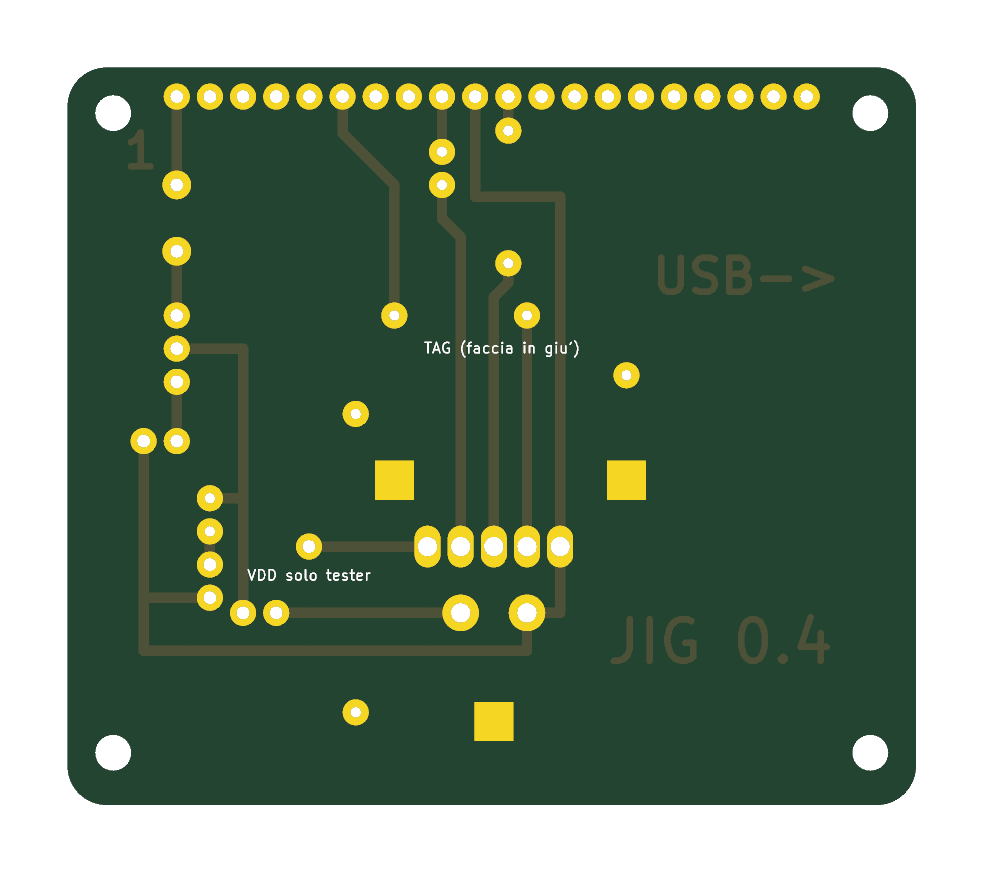

- **Header connections:** pin 2 (5 V, charging only, via PTC and jumper), 12 (RESET, GPIO18), 18 (SWDIO, GPIO24), 20 (GND), 22 (SWCLK, GPIO25). 1 kOhm series resistors on SWD and RESET.
- **Golden rule:** never the Pi's 3.3 V on the tag's VDD. The tag is powered by its cell; at first boot its VDD is 1.8 V until `UICR.REGOUT0` is written.
- **Charging:** VIN and GND pogo pins charge the 401012 cell through the BQ25101 (13.5 mA, about 3-3.5 hours from empty). Jumper JP1: none = charging off (default), 1-2 = Pi 5 V, 2-3 = external 5 V.
- **Alignment:** three stop pins on the edges with the tag's notches, estimated error about +/-0.3 mm.
- **OpenOCD:** file `swimtag_pi.cfg` (driver `bcm2835gpio`, peripheral base 0x3F000000 for Pi 3 and 0xFE000000 for Pi 4). Pi 5 not supported.
- **DRC 0, ERC 0** with `kicad-cli` 10.0.6.
- **Not tested physically:** the board has not been built. Known risks: 1.8 V levels on the tag (1 kOhm resistors are not a level translation), pogo hole to verify on the real part, header position to verify on a real Pi.

**Documentation:**
- [`hardware/programmatore/Programmatore_SwimTag_v0.5.pdf`](hardware/programmatore/Programmatore_SwimTag_v0.5.pdf): schematic, bill of materials, procedure, OpenOCD (Italian). The 1:1 prints are on pages 6 (mirrored copper), 7 (components), 8 (2:1 enlargement) and 9 (drill map).
- [`hardware/programmatore/README.md`](hardware/programmatore/README.md): details, pinout, procedure and limits (Italian).
- [`hardware/programmatore/bom.md`](hardware/programmatore/bom.md): bill of materials with prices.
- [`hardware/programmatore/stampa/`](hardware/programmatore/stampa/): 1:1 print sheets.

## Poolside display mockup and proposed architecture

### Display mockup: `tools/display.html`

[`tools/display.html`](tools/display.html) is a self-contained HTML mockup (English UI, no dependencies) of the poolside display. Open it in a browser. All data are invented. Live demo: <https://swimtimer-pzero.web.app/display/?demo&vel=10> (the `?demo&vel=` parameters set demo mode and speed).

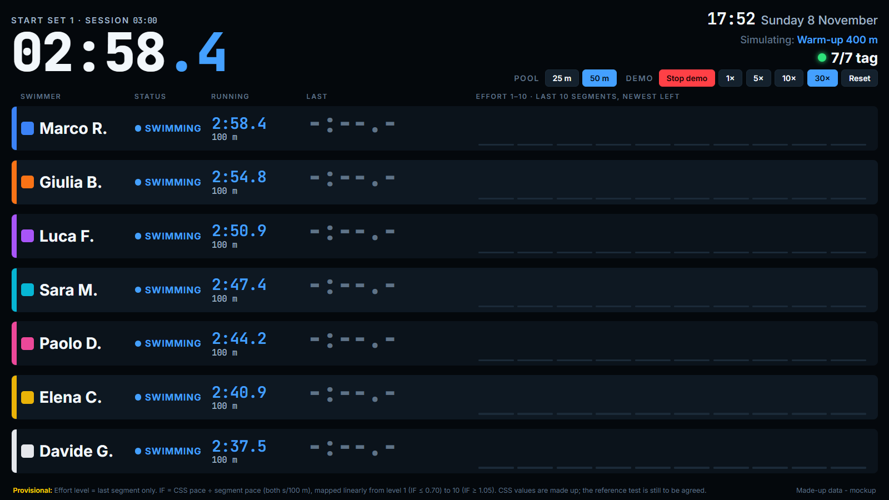

- **One row per swimmer:** colour code, name, state (Swimming / Rest / Waiting / Done).
- **Running time** of the current segment with its distance.
- **Last time** with distance, pace and per-lap splits.
- **Effort 1-10**, computed on the last segment only. Provisional: based on CSS and pace; the reference test is still to be agreed.
- **History of the last 10 segments:** the newest enters on the left and blinks for 5 s, the others slide right.
- **Large clock** that restarts when the first swimmer begins a new segment, with the previous lap duration in grey beside it. It stops at the end of the workout.
- **Generic segment model:** start to arrival, any distance. No workout is loaded, because the display will be offline. Pool length selectable: 25 or 50 m.
- **Single entry point:** `ricevi({tag, tipo, t_ms})`. A real BLE source can be connected there later.
- **Demo mode:** 7 swimmers staggered by 3-5 s run a workout (400 warm-up, 4x100 technique, 3x(300 + 4x100), 200 cool-down). Speed 1x / 5x / 10x / 30x; the simulated phase is shown under the date.

### Proposed display architecture (not yet confirmed)

| Item | Proposal |
|---|---|
| Computer | Raspberry Pi 4 |
| Radio | USB nRF52840 dongle |
| Screen | 15.6 inch portable monitor |
| Power | USB-C PD power bank |
| Software | Native program, Wi-Fi off |
| Consumption and runtime | About 13 W, about 2 h on battery |
| Connections | Up to 10 tags |
| Data | Tags record events with their own clock and keep them until the display confirms. Only events are stored: about 60 KB for 10 tags in 2 h. |

**Open problem:** BLE does not reach the opposite wall in a 50 m pool.

## Planned features and ideas

Not implemented. They come from design discussions and are recorded in [`docs/DECISIONI.md`](docs/DECISIONI.md) and [`docs/DESIGN.md`](docs/DESIGN.md) (Italian).

- **Team charging base with slots (planned).** A base that charges several tags at once. Each swimmer owns a passive **NFC token** and leaves it in the slot of the tag they take; this associates swimmer and tag. The base **arms** the tag, and at the end of the workout downloads its data and sends it to the poolside display. An unarmed tag does not record. Reasons: the display is not a touch screen and may be far from the athletes, no phone is needed at the pool, and the token deters theft.
- **"% effort" on the display (idea).** Estimated from pace relative to the swimmer's personal Critical Swim Speed (CSS), plus stroke-rate and stroke-length fatigue. It is an **effort estimate, explicitly not physiological stress**: no heart rate or other physiological sensor is used.
- **Final version without external flash (idea).** The tag would record only events (start, turns, stop), with a circular buffer of about 10 s in RAM. This removes the flash and the long raw recordings, which remain a development tool.
- **Other items.** Vibration motor and pressure sensor in the final version (removed from the economy boards).

## Technical wallpaper gallery

Twenty 1170 x 2532 px drawing sheets generated from the real PCBs (blueprint, OLED, technical paper, copper on green). Generated on **v0.5**. Full images in [`hardware/wallpaper_v0.5/png/`](hardware/wallpaper_v0.5/png/) (files `NN_name_1170x2532.png`, same names as v0.4).

| &nbsp; | &nbsp; | &nbsp; | &nbsp; |
|---|---|---|---|
| 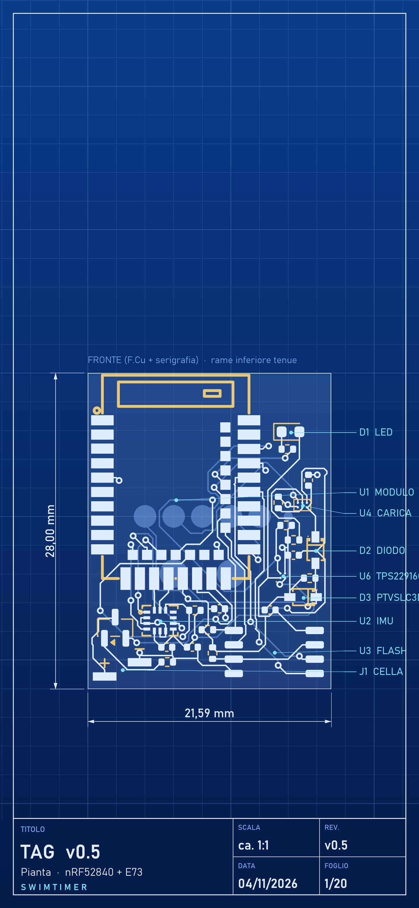<br>**01** Tag plan | 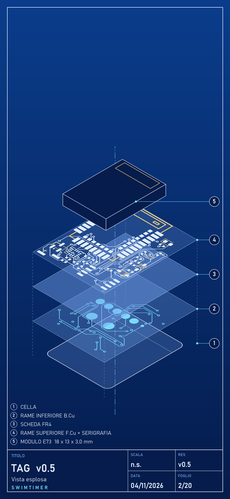<br>**02** Exploded view | 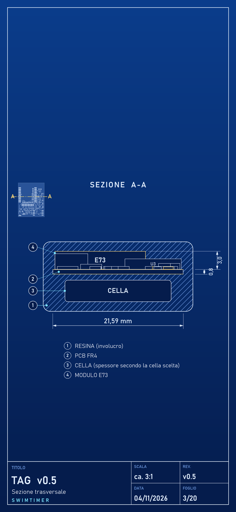<br>**03** Section | 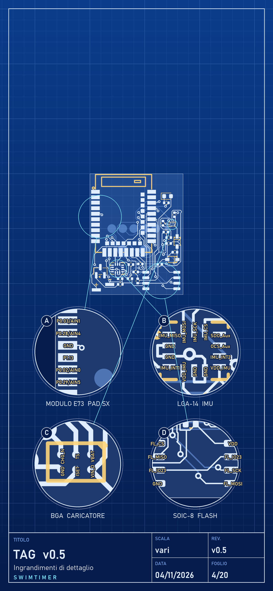<br>**04** Details |
| 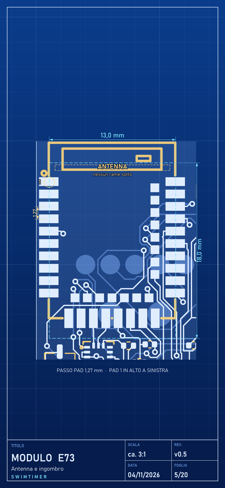<br>**05** E73 and antenna | 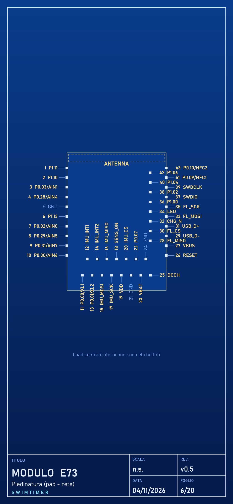<br>**06** E73 pinout | 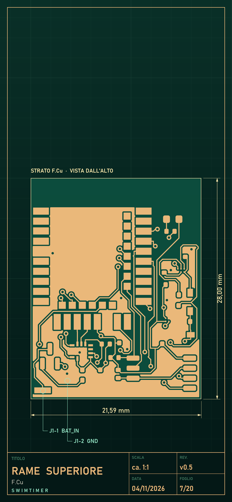<br>**07** Top copper | 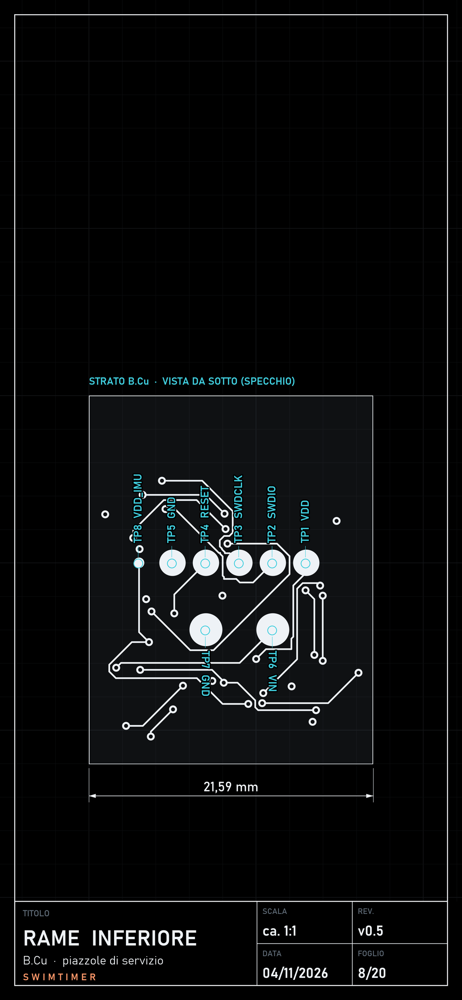<br>**08** Bottom copper |
| 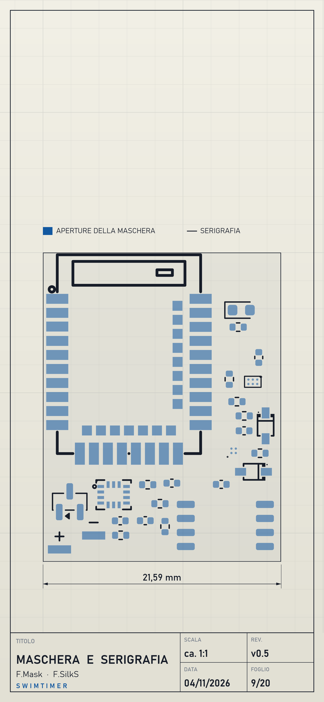<br>**09** Mask and silkscreen | 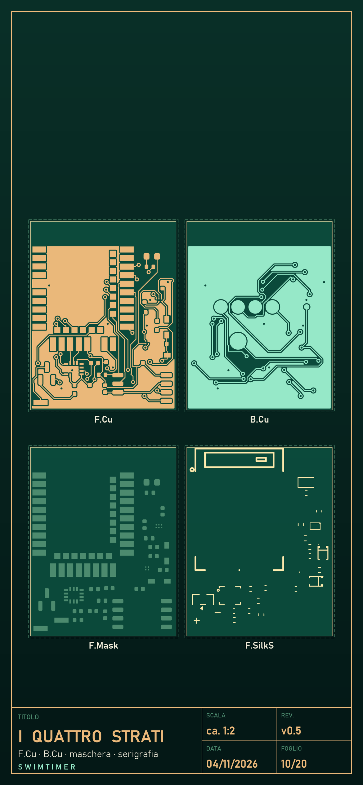<br>**10** Layers (stack view) | 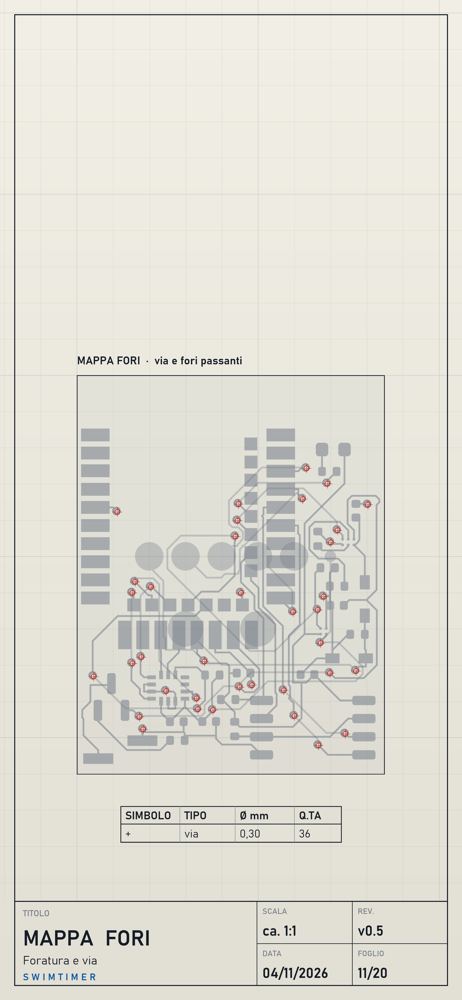<br>**11** Drill map | 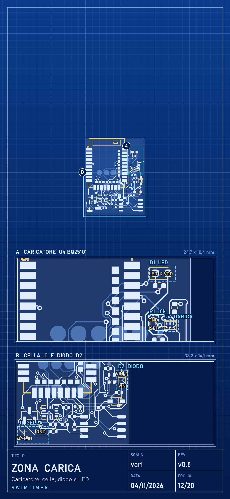<br>**12** Charging zone |
| 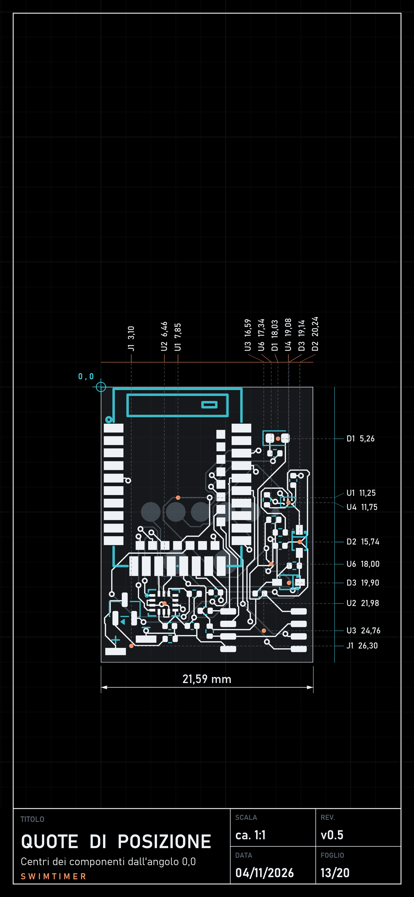<br>**13** Dimensions and positions | 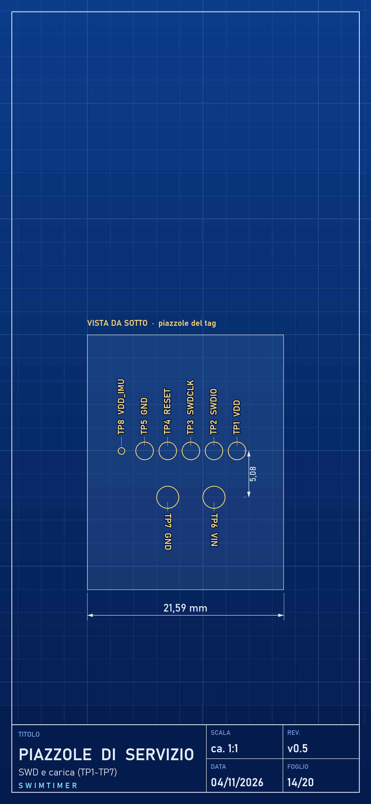<br>**14** Service pads | 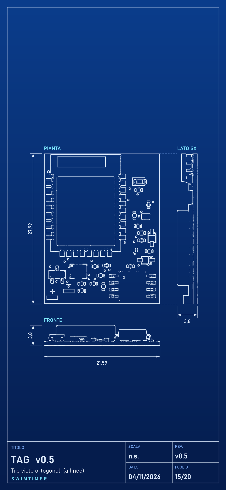<br>**15** Three views | 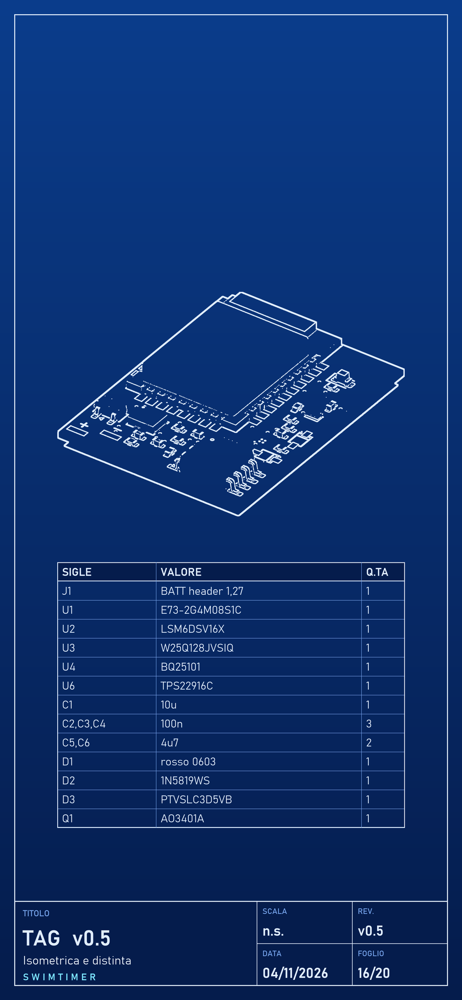<br>**16** Isometric with BOM |
| 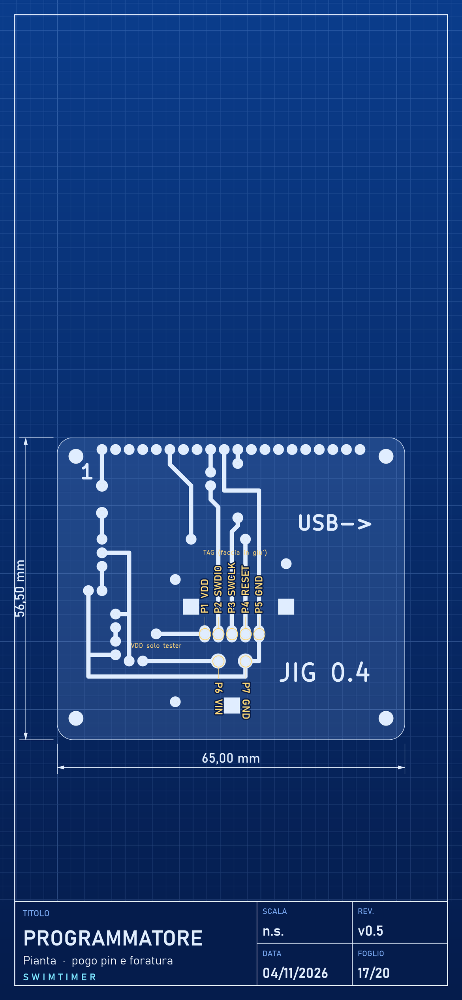<br>**17** Programmer, plan | 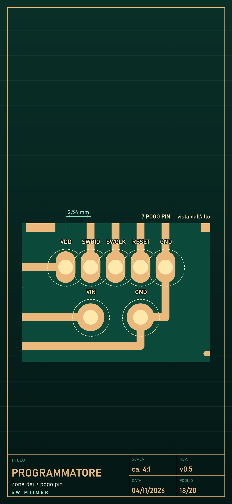<br>**18** Programmer, pogo pins | 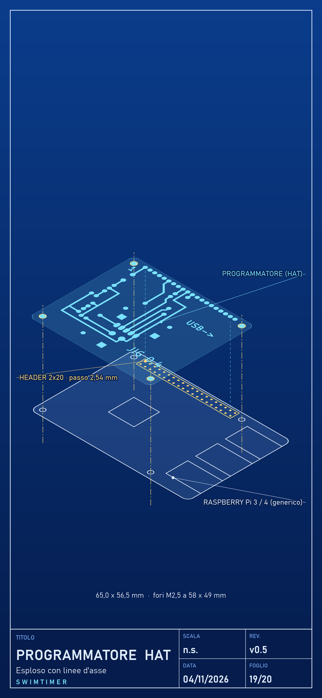<br>**19** Programmer, HAT | 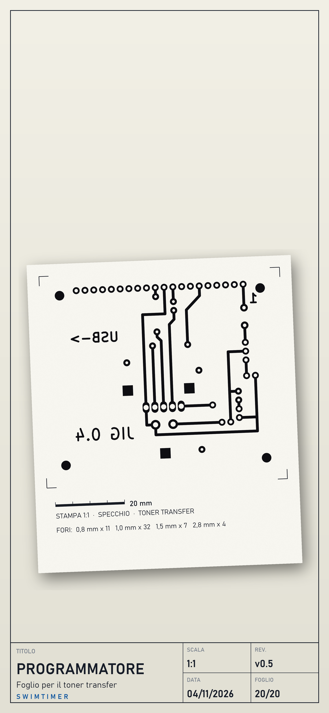<br>**20** Programmer, toner transfer |

**How to regenerate them.** `python hardware/wallpaper_v0.5/genera.py` (requires `kicad-cli` and PyMuPDF). Options: `--solo 1 3 12`, `--bozza`, `--forza` to redo the 3D renders too. The v0.4 wallpapers remain in [`hardware/wallpaper_v0.4/png/`](hardware/wallpaper_v0.4/png/) (historical). The v0.3 wallpapers, old and historical only, are in [`hardware/nrf52840/wallpaper/png/`](hardware/nrf52840/wallpaper/png/).

## Repository structure

```
SwimTimer/
├── app/                          online collaboration app: landing (index.html), members' area (area/), shared scripts (comune/, incl. i18n.js), img/, versione.json; strumenti/ and display/ are copies made at deploy
├── docs/                         img/ (mockups), SINCRONIZZAZIONE.md (sync protocol), idea, state, decisions, open questions, requirements, design, data model (MODELLO-DATI.md), lessons, algorithms (Italian)
├── firebase/                     Firestore security rules, indexes, scrivi-versione.mjs, prepara-strumenti.mjs, test/ (17 rule tests)
├── firebase.json, .firebaserc    Firebase Hosting and Firestore configuration
├── firmware/
│   ├── test-collegamenti/        ESP32-S3 tag: firmware 0.4.3
│   ├── xiao-stream/              XIAO nRF52840 Sense: BLE streaming + OTA, recording, ring flash and sync 0.6.0, .swr tools (release/ xiao.bin, xiao.json = 0.5.4)
│   ├── display-sync/             T-RGB display: tag synchronization, 3 tags, microSD, DEMO (PlatformIO)
│   └── display-prova/            T-RGB display (first test)
├── tools/                        index.html (XIAO tools page: Live, Recording, Annotation, Firmware), annotazione.js/.css, registrazione.js, swr.js, test_swr2.mjs, parita_swr.mjs, display.html (poolside display mockup)
├── analisi/video/                OpenCV analysis of the underwater video (stabilisation, background, skin filter, classification, tuning, comparison)
├── analisi/imu/                  IMU test bench: dataset, streaming simulator, evaluation, validation, sample-rate experiment, 5 tests
├── media/video/                  three videos: first presentation, progress update, first pool test (generators genera_video*.py, music, texts, STORYBOARD_v3.md, prepara_img_v3.py; .mp4 and real images not in git)
├── media/display/                screenshots of the poolside display mockup
├── hardware/
│   ├── bom.md, schema.md         ESP32 prototype
│   ├── xiao/                     XIAO nRF52840 Sense test tags (README.md)
│   ├── nrf52840/                 custom board: progetto.md, bom.md, verifiche.md, verifica_v0.4.md,
│   │   │                         revisioni_esterne.md, revisione_esterna_v0.4.md / v0.5.md, ingombro*.svg, v0.3 PDF and wallpapers
│   │   └── kicad/                scripts, KiCad projects (swimtag, _collaudo, _economica, _v06),
│   │                             jlc/ (v0.3 ... v0.6), nextpcb/ (v0.5, panels 3x1 and 2x1, v0.6),
│   │                             verifica_v04/v05/v06.py
│   ├── programmatore/            Raspberry Pi HAT: KiCad, PDF, 1:1 prints, scripts
│   ├── wallpaper_v0.5/           genera.py, estrai_dati.py, render/, png/ (20 wallpapers, v0.5)
│   └── wallpaper_v0.4/           v0.4 wallpapers (historical)
├── CHANGELOG.md                  changes by date
├── CLAUDE.md                     project working rules
└── README.md                     this file
```

## How to regenerate the files

All commands from the repository root. Scripts are in `hardware/nrf52840/kicad/`.

| What | Command | Notes |
|---|---|---|
| Schematic and PCB (v0.5) | `SWIMTAG_VARIANTE=economica python hardware/nrf52840/kicad/genera_schema.py` and `genera_pcb.py` | data in `dati_economica.py`, positions in `posizioni_economica.py` |
| Routing | `sbroglia.py` | Freerouting 2.5.0, Java 25; non-deterministic: repeat until DRC is 0 |
| Netlist check | `verifica_netlist.py` | compares the netlist with the data |
| Independent check | `python hardware/nrf52840/kicad/verifica_v05.py <pcb> <net.xml> [cpl.csv bom.csv]` | EXPECTED table hand-written from datasheets (`verifica_v04.py` for v0.4, `verifica_v06.py` for v0.6) |
| JLC files | `SWIMTAG_VARIANTE=economica python hardware/nrf52840/kicad/esporta_jlc.py` | writes to `jlc/v0.5_swimtag_economica/` |
| NextPCB files | `python hardware/nrf52840/kicad/esporta_nextpcb.py` | writes to `nextpcb/`; panels with `crea_pannelli.py`; XLSX from CSV with `csv_a_xlsx.py` |
| v0.6 board | `dati_v06.py`, `posizioni_v06.py`, `genera_schema.py` / `genera_pcb.py`, `cuci_massa.py` (ground stitching), `disegno_montaggio_v06.py` | project `swimtag_v06.*`; check the scripts' arguments before running |
| Programmer | `cd hardware/programmatore; python genera_kicad.py --drc` then `python genera_pdf.py` | re-reads TP1-TP7 from the tag PCB; PDF needs PyMuPDF and `kicad-cli` |
| Wallpapers | `python hardware/wallpaper_v0.5/genera.py` | see gallery |

v0.4 is regenerated from commit `8fd6cc0`; v0.3 with `SWIMTAG_VARIANTE=collaudo` (default).

## Ordering flow: JLCPCB and NextPCB

The v0.5 board is verified (DRC/ERC, `verifica_v05.py`). **Do not order** before: cost decision (~125 EUR against the 100 EUR cap), JLC preview, HASL/ENIG choice, DFM ticket. For v0.6, also verify the rotations of the SOT-23 parts.

**JLCPCB**
1. Regenerate the JLC files and check `bom_jlc.csv` and `cpl_jlc.csv`.
2. Upload the Gerber zip (`swimtag_gerber.zip`) in the PCB order: 2 layers (v0.5) or 4 layers (v0.6), 0.8 mm, **lead-free HASL or ENIG** (user's choice, see the verification).
3. **Standard PCBA** assembly service (mandatory for v0.5: E73, IMU and BQ25101 are "Standard only"), top side, **PCBA Qty = 2**; if asked, process edges "Added by JLCPCB".
4. Upload BOM and CPL and check in the preview the rotations and pin 1 of E73, IMU (LGA), BQ25101 (BGA), TPS22916C (U6, probably "Standard only"), Q1 (SOT-23), flash (U3 at 270 degrees), LED (D1), Schottky (D2), TVS (D3) and header (J1); E73 stock.
5. Apply the **coupons** from the Coupon Center: *PCBA Special Offer* (8.05 EUR) and *JLCONE PCB* (order from the JLCONE app).
6. Enable **Confirm Parts Placement** (0.45 EUR) to approve placement before production.
7. Add **X-ray** for E73, IMU, BQ25101 and the other parts with hidden pads (about +10 USD).
8. Open a DFM ticket with JLC for the two 0.4 mm packages (BQ25101 and TPS22916C).
9. Check the total (target <= 100 EUR with VAT, see cuts in [v0.5 costs](#v05-costs)), then pay. Cell, pogo pins and programmer are excluded.

**NextPCB**
1. Use the files in `hardware/nrf52840/kicad/nextpcb/` (`v0.5`, panels `v0.5_pannello_3x1` / `v0.5_pannello_2x1`, or `v0.6`): Gerber zip, BOM, CPL/centroid.
2. Panels use mouse bites; J1 is not assembled (solder the cell wires by hand).
3. The Rev0 service rejects BGA parts with pitch below 0.45 mm: this is why v0.6 exists.
4. Check pin 1 and rotations in `assembly_top_render.png` and `assembly_pin1.png` (v0.6) before paying.

## Roadmap and open issues

**nRF52840 board**
1. Decide the cost: ~125 EUR against the 100 EUR cap (cuts: X-ray, TVS, header), or the NextPCB route with v0.6.
2. Verify the v0.6 SOT-23 rotations in a JLC preview; choose HASL/ENIG, DFM ticket, order 2 boards.
3. Bench test of Q1 with the cell connected correctly and reversed (v0.5); first power-up from a supply limited to about 50 mA.
4. Build the programmer, write UICR, antenna range test before the resin (antenna 0.3 mm from the edge, 28 mm board).
5. Firmware on Zephyr / nRF Connect SDK (SPI, flash, recording, MCUboot, sleep with IMU INT), then pool tests.
6. Final version: motor, pressure sensor, multi-slot charging base with NFC association (see [Planned features and ideas](#planned-features-and-ideas)).

**Tag to display synchronization**
- Stability: ERROR advertisement before sleep, display timeout/watchdog.
- Check the microSD contents from the PC, tune the signal strength, long-duration test and edge cases.
- Publish firmware 0.6.0 as the OTA release after the tests.

**Poolside display**
- Confirm the Raspberry Pi 4 + nRF52840 dongle architecture, then wire `ricevi()` to a real BLE source.
- Solve BLE coverage of the far wall in a 50 m pool.
- Agree the reference test for the Effort 1-10 indicator.

**XIAO test tags**
- Order 2 boards and the cells (1000 mAh in use for the tests), dry-run the waterproofing. Firmware ported (`firmware/xiao-stream`): published release is 0.5.4 (the version used in the first pool test on 9 November 2026; the OTA install of this release package from the page is not yet tested). Still to do: dry run at home (2-taps-blue-2-taps wake, recording and download over USB), low-battery sleep, Battery panel and VCAL calibration, then **test campaign 1** (one swimmer, 50 m pool, wall drills, then a training session for verification, with hand annotation of all events).

**Analysis**
- Build the labelled dataset from the OpenCV reference, validate with one session left out, train the finish network and compare it with a classical method; more sessions and more swimmers needed.

**Tools page and online app**
- Check the real XIAO end to end on the tools page over USB (download, `.swr` decoding, annotation) and run `tools/parita_swr.mjs` on a real recording.
- Add 25 fps support to the Annotation tab (frame stepping is wrong at 25 fps).
- Online app: first real session uploaded (Upload online from `/strumenti/`) and viewed by an approved member; test the Google Drive shared-folder flow for videos; read and answer the first contact messages from the Messages page; check the Firebase Spark quotas on real use.

**ESP32 prototype**
- On battery only, the tag does not flash blue and is not visible over Bluetooth (red LED on, 3.87 V at the pads).
- BMI160 latch-up after abrupt power-offs: the main switch is used.
- Battery-powered display does not turn on without USB.
- Unreliable software tap; BMI160 FIFO reading (about 44 Hz real).
- Sessions recorded with video, algorithm tuning, pool test.

**General risks**
- Patents in the field (FORM US 11833392): freedom-to-operate check before any commercial use.
- BLE does not cross water; waterproof case and resin to be defined.
- Automated tests cover only the `.swr` decoders (11 unit tests, invented data) and the Firestore rules (17 emulator tests). The tools page and the members' area are tested by hand.
- Sessions are health data: the online app stores them in Firestore; the approval process and the rules are the only protection.

Details: [`docs/STATO.md`](docs/STATO.md) (Italian). Decisions: [`docs/DECISIONI.md`](docs/DECISIONI.md) (Italian). Changes: [`CHANGELOG.md`](CHANGELOG.md).

## Contributing

Contributions are not open yet. Issues and suggestions are welcome on GitHub. Working documents are in Italian; code, scripts and this README accept English.

## Privacy and security

- No credentials in the repository: if needed, only in `.env` (excluded from git) and as CI secrets.
- No real personal data: swim sessions are health data and stay local (`dati/`, excluded from git). Tests use invented data only.
- Since 2026-11-04 the whole project, hardware included, lives in this single public repository; the old private repository `PZero/SwimTimer-nrf52840` is retired.
- Online app: Firebase Spark (free) plan, no Cloud Storage and no Cloud Functions; access by administrator approval; security rules tested on the emulator.
- Contact form: messages contain the e-mail address and text that the sender chooses to write (name optional). They are stored in Firestore and readable only by the administrator; the repository contains no real message. The administrator's user ID is in the public rules file: it identifies the account, it is not a secret.
- No personal data in the repository: swim sessions, videos and annotation projects stay out of git (see `.gitignore`).

## License and author

Project license: to be defined (no `LICENSE` file). The driver in `firmware/display-prova/src/trgb/` is under the MIT license (Copyright 2024 Xinyuan-LilyGO), with its own `LICENSE` file.

Author: PZero (GitHub `PZero`).
