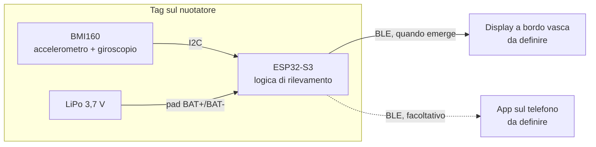

# SwimTimer

Tempi automatici in piscina: un tag indossato dal nuotatore e un display a bordo vasca riconoscono partenza e arrivo, senza pulsanti.

-yellow) 

**Foto dei dispositivi:** da definire (da aggiungere in `docs/foto/`).

## Indice
- [Panoramica](#panoramica)
- [Funzionalità](#funzionalità)
- [Architettura](#architettura)
- [Hardware](#hardware)
- [Firmware](#firmware)
- [Costruzione e assemblaggio](#costruzione-e-assemblaggio)
- [Uso in vasca](#uso-in-vasca)
- [App](#app)
- [Struttura delle cartelle](#struttura-delle-cartelle)
- [Stato del progetto e roadmap](#stato-del-progetto-e-roadmap)
- [Contribuire](#contribuire)
- [Licenza](#licenza)
- [Autore](#autore)

## Panoramica

**Problema.** In piscina i tempi per vasca e i riposi si perdono. Il cronometro a muro non sempre c'è, e guardare l'orologio interrompe l'allenamento.

**A chi serve.** A chi nuota in vasca e vuole tempi e riposi senza toccare nulla durante la prova.

**Cosa fa.** Un piccolo tag, fissato alla cuffia o all'elastico degli occhialini, misura il movimento con un sensore inerziale. Riconosce la spinta dal muro (partenza), la calma all'arrivo (stop) e le virate. Un display a bordo vasca mostra i tempi.

Il BLE non attraversa l'acqua: il tempo non si misura con il segnale radio. Il BLE serve a riconoscere la vicinanza al display e a inviare i dati.

Analisi completa e ipotesi di logica: [`docs/IDEA.md`](docs/IDEA.md).

## Funzionalità

| Funzione | Stato |
|---|---|
| Lettura di accelerazione (3 assi) e rotazione (3 assi) dal sensore BMI160 | Prototipo verificato |
| Invio dei dati grezzi via USB a circa 50 Hz | Prototipo verificato |
| Visualizzazione dei 3 assi con grafici nel browser | Funzionante (`tools/assi.html`) |
| Riconoscimento della partenza dalla spinta | Da sviluppare |
| Riconoscimento dell'arrivo (tag vicino al display e calma di circa 3 s) | Da sviluppare |
| Conteggio delle virate, registrate come parziali | Da sviluppare |
| Registrazione dei dati in memoria per le prove in vasca | Da sviluppare |
| Display a bordo vasca con i tempi | Da definire |
| App di accompagnamento e storico | Da definire (facoltativa) |

## Architettura

Schema a blocchi, con i componenti del prototipo e quelli previsti:



### Tag
- **Microcontrollore:** ESP32-S3 SuperMini (USB-C, LED RGB, pulsanti BOOT e RST).
- **Sensore:** Bosch BMI160 su modulo GY-BMI160, 6 assi, indirizzo I2C `0x68`. Non ha magnetometro.
- **Alimentazione:** LiPo a una cella sui pad BAT+ e BAT- dell'ESP32-S3. Il caricatore è integrato nella scheda.
- **Contenitore:** da definire.

### Display
Da definire. Requisiti attesi: cifre leggibili a bordo vasca e ricezione BLE dal tag.

### Flusso dei dati, dal sensore al tempo
1. Il BMI160 misura accelerazione e rotazione.
2. L'ESP32-S3 legge il sensore via I2C (GPIO 8 SDA, GPIO 9 SCL).
3. La logica di rilevamento riconosce la spinta (START), le virate e la calma (STOP). L'ora dello STOP è quella della decelerazione all'arrivo, non quella della fine della calma.
4. Il tag salva gli eventi con l'ora.
5. Quando il tag emerge, invia gli eventi al display via BLE. Bastano pochi millisecondi di contatto.
6. Il display calcola i tempi e li mostra.

Oggi sono realizzati i passi 1 e 2: il firmware di prova invia le letture via USB (vedi [Firmware](#firmware)).

## Hardware

Distinta completa: [`hardware/bom.md`](hardware/bom.md). Schema e collegamenti: [`hardware/schema.md`](hardware/schema.md).

| Componente | Modello | Funzione |
|---|---|---|
| Microcontrollore | ESP32-S3 SuperMini | logica, BLE, USB |
| Sensore inerziale | GY-BMI160 | accelerazione e rotazione |
| Batteria | LiPo 3,7 V, una cella (capacità da scegliere, indicativamente 300–500 mAh) | alimentazione |
| Partitore (facoltativo) | 2 resistenze da 100 kΩ | lettura del livello batteria |
| Display | da definire | tempi a bordo vasca |

### Collegamenti del tag (prototipo)

| Da | A | Note |
|---|---|---|
| ESP32-S3 3V3 | BMI160 3V3 | alimentazione del sensore |
| ESP32-S3 GND | BMI160 GND | |
| ESP32-S3 GPIO 8 | BMI160 SDA | I2C |
| ESP32-S3 GPIO 9 | BMI160 SCL | I2C |
| ESP32-S3 GPIO 4 | BMI160 INT1 | risveglio al movimento (per il risparmio energia) |
| ESP32-S3 3V3 | BMI160 CS | CS alto: modalità I2C |
| ESP32-S3 GND | BMI160 SAO | indirizzo `0x68` |
| GPIO 1 | partitore sulla batteria | facoltativo |

Lo schema dettagliato è in [`hardware/schema.md`](hardware/schema.md).

### Alimentazione e autonomia
- La LiPo va sui pad BAT+ e BAT- dell'ESP32-S3. La scheda gestisce la carica dalla USB-C.
- Usare una LiPo con protezione propria: il caricatore integrato non protegge dalla scarica eccessiva.
- Con la batteria scarica il regolatore dà meno di 3,3 V: il firmware deve spegnersi sotto circa 3,3 V.
- Capacità della batteria, autonomia e metodo di spegnimento: da definire.

### Impermeabilità
Da definire. Ipotesi: involucro sigillato con resina o guscio, da provare in vasca con sacchetto stagno.

## Firmware

Il firmware di registrazione non è ancora scritto. Oggi è disponibile il test dei collegamenti.

### `firmware/test-collegamenti/`
Sketch di verifica per Arduino, che esegue in sequenza:
- scansione del bus I2C sui pin 8 e 9, anche con SDA e SCL scambiati;
- lettura del chip ID del BMI160, atteso `0xD1`;
- accensione di accelerometro e giroscopio in modalità normale, con verifica dello stato (`0x14`);
- invio di una riga dati per campione, a circa 50 Hz. Fondo scala: ±2 g e ±2000 °/s;
- diagnostica una volta al secondo: stato del sensore, livello di INT1 e tensione della batteria (se il partitore è montato).

Formato delle righe dati:
```
D,<millisecondi>,<ax g>,<ay g>,<az g>,<gx °/s>,<gy °/s>,<gz °/s>
```
Le altre righe sono diagnostica.

### Compilazione e caricamento
Requisiti: [Arduino CLI](https://arduino.github.io/arduino-cli/) e il core `esp32:esp32` versione 3.3.12 (per esempio con `arduino-cli core install esp32:esp32@3.3.12`).

Compilazione e caricamento dalla USB dell'ESP32-S3. Sostituire `<COM>` con la porta (per esempio `COM5`):
```
arduino-cli compile --fqbn esp32:esp32:esp32s3:CDCOnBoot=cdc --upload -p <COM> firmware/test-collegamenti
```
L'opzione `CDCOnBoot=cdc` manda la seriale sulla USB dell'ESP32-S3. Il monitor seriale va impostato a 115200 baud.

### Strumento di controllo: `tools/assi.html`
Pagina HTML che legge le righe `D,` dalla seriale e mostra valori e grafici dei 3 assi di accelerazione e rotazione.
- Richiede Chrome o Edge (Web Serial API).
- Aprire il file nel browser, premere **Collega il tag** e scegliere la porta dell'ESP32-S3.
- Il filtro mostra solo le porte con vendor USB `0x303a` (Espressif).

### Funzioni previste
- Registrazione in memoria di accelerazione, rotazione e segnale BLE per le prove in vasca.
- Logica di START, STOP e virate, con la soglia di calma (circa 3 s).
- Sonno profondo con risveglio dal BMI160 su INT1.
- Ricezione BLE sul display.

Test automatici: da definire (`pio test` non è ancora impostato).

## Costruzione e assemblaggio

Procedura del prototipo:
1. Verificare i componenti con [`hardware/bom.md`](hardware/bom.md).
2. Saldare il BMI160 all'ESP32-S3 secondo la tabella [Collegamenti del tag](#collegamenti-del-tag-prototipo).
3. Collegare la LiPo ai pad BAT+ e BAT- e verificare la polarità prima di collegarla.
4. Caricare `firmware/test-collegamenti` e controllare il messaggio `BMI160 chip ID: 0xD1 (OK)`.
5. Aprire `tools/assi.html` e verificare i valori con il tag fermo:
   - un asse di accelerazione vale circa ±1 g e gli altri circa 0 g;
   - il giroscopio vale circa 0 °/s su tutti gli assi.
6. Muovere il tag e verificare che ogni asse risponda.

Involucro e fissaggio al nuotatore: da definire.

## Uso in vasca

Stato: la logica è in fase di definizione e le prove in vasca non sono ancora state fatte.

Ipotesi di funzionamento (dettagli in [`docs/IDEA.md`](docs/IDEA.md)):
- **Posizione:** cuffia o elastico degli occhialini, dietro la testa. È la parte che emerge più spesso e più vicina al muro.
- **Partenza (START):** picco di spinta dal muro, misurato dall'accelerometro.
- **Virata:** dura meno di 1–2 s ed è seguita da una nuova spinta. Viene registrata come virata parziale e non ferma il cronometro.
- **Arrivo (STOP):** tag vicino al display e calma per almeno circa 3 s. L'ora è quella della decelerazione all'arrivo.
- **Riposo:** dallo STOP alla spinta successiva.
- **Display:** previsto sul lato di partenza, con distanze multiple di 100 m.

Domande aperte per le prove (piscina da 25 o 50 m, tipo di prova): [`docs/DOMANDE-APERTE.md`](docs/DOMANDE-APERTE.md).

## App

Da definire. L'app è facoltativa e servirebbe per lo storico sul telefono.

Se verrà sviluppata, seguirà questi vincoli del progetto:
- backend Firebase con piano gratuito Spark, senza Cloud Functions e senza spese;
- sicurezza affidata alle regole di Firestore.

Installazione, avvio, test e deploy: da definire.

## Struttura delle cartelle

```
SwimTimer/
├── docs/                  idea, stato, decisioni, domande aperte, requisiti, design
├── hardware/              distinta componenti (bom.md), schema (schema.md); involucro da creare
├── firmware/              test-collegamenti/: verifica del BMI160 e dei collegamenti
├── tools/                 assi.html: visualizzazione dei 3 assi via Web Serial
├── .claude/               agenti e comandi per Claude Code (non è codice del prodotto)
├── CHANGELOG.md           modifiche per data
├── CLAUDE.md              regole di lavoro del progetto
├── .gitignore             esclude segreti, dati personali e file di build
└── README.md              questo file
```

Esclusi da git (vedi `.gitignore`): file con segreti (`.env`, chiavi, account di servizio) e la cartella `dati/` per le sessioni di nuoto reali.

## Stato del progetto e roadmap

**Fase 1: prototipo del tag.** Il tag di prova è saldato e il sensore risponde su tutti gli assi.

Prossimi passi:
1. Firmware di registrazione: salvataggio di accelerazioni, rotazioni e segnale BLE per le prove in vasca (sacchetto stagno).
2. Prova in vasca e analisi dei dati: spinta dal muro, virata, arrivo, soglie di calma.
3. Display a bordo vasca: scelta dei componenti e firmware di ricezione BLE.
4. Involucro impermeabile e fissaggio al nuotatore.
5. App di accompagnamento, se confermata.

Problemi aperti (dettagli in [`docs/STATO.md`](docs/STATO.md)):
- protezione della batteria e metodo di spegnimento del tag da definire;
- capacità della LiPo e autonomia da definire;
- nessun test automatico.

Decisioni: [`docs/DECISIONI.md`](docs/DECISIONI.md). Modifiche: [`CHANGELOG.md`](CHANGELOG.md).

## Contribuire

Il progetto è in fase di prototipo. Segnalazioni e proposte sono benvenute come issue. Linee guida per le pull request: da definire.

Regole del repository:
- nessuna credenziale nel codice o nei documenti;
- nessun dato personale reale: le sessioni di nuoto sono dati di salute e restano in locale, nella cartella `dati/` esclusa da git. Nei test si usano solo dati inventati.

## Licenza

Da definire. Il repository non contiene ancora un file `LICENSE`.

## Autore

PZero (GitHub `PZero`).
