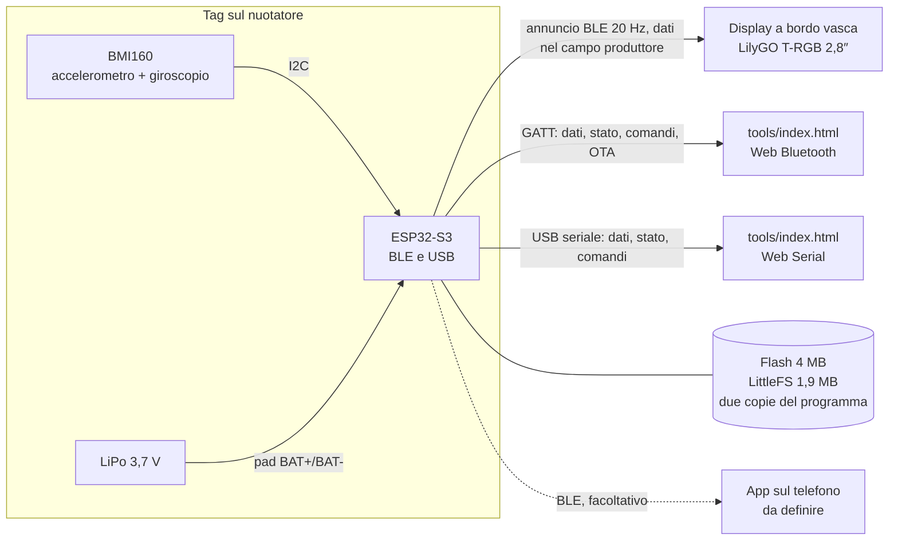

# SwimTimer

Tempi automatici in piscina: un tag indossato dal nuotatore e un display a bordo vasca riconoscono partenza e arrivo, senza pulsanti.

-yellow) 

**Foto dei dispositivi:** da definire (da aggiungere in `docs/foto/`).

## Indice
- [Panoramica](#panoramica)
- [Funzionalità](#funzionalità)
- [Architettura](#architettura)
- [Hardware](#hardware)
- [Firmware](#firmware)
- [Pagina di analisi](#pagina-di-analisi)
- [Aggiornamento del firmware e versioni](#aggiornamento-del-firmware-e-versioni)
- [Compilazione automatica e GitHub Pages](#compilazione-automatica-e-github-pages)
- [Costruzione e assemblaggio](#costruzione-e-assemblaggio)
- [Uso in vasca](#uso-in-vasca)
- [App](#app)
- [Struttura delle cartelle](#struttura-delle-cartelle)
- [Stato del progetto e roadmap](#stato-del-progetto-e-roadmap)
- [Privacy dei dati di nuoto](#privacy-dei-dati-di-nuoto)
- [Brevetti e ricerca](#brevetti-e-ricerca)
- [Contribuire](#contribuire)
- [Licenza](#licenza)
- [Autore](#autore)

## Panoramica

**Problema.** In piscina i tempi per vasca e i riposi si perdono. Il cronometro a muro non sempre c'è, e guardare l'orologio interrompe l'allenamento.

**A chi serve.** A chi nuota in vasca e vuole tempi e riposi senza toccare nulla durante la prova.

**Cosa fa.** Un piccolo tag, fissato alla cuffia o all'elastico degli occhialini, misura il movimento con un sensore inerziale. Riconosce la spinta dal muro (partenza), la calma all'arrivo (stop) e le virate. Un display a bordo vasca mostra i tempi.

Il BLE non attraversa l'acqua: il tempo non si misura con il segnale radio. Il BLE serve a riconoscere la vicinanza al display e a inviare i dati.

Analisi completa e ipotesi di logica: [`docs/IDEA.md`](docs/IDEA.md). Ricerca sugli algoritmi: [`docs/RICERCA-ALGORITMI.md`](docs/RICERCA-ALGORITMI.md).

## Funzionalità

| Funzione | Stato |
|---|---|
| Lettura di accelerazione (3 assi, ±16 g) e rotazione (3 assi, ±2000 °/s) dal BMI160 a 100 Hz nominali | Firmware 0.4.3 compilato; letture provate con le versioni precedenti |
| Registrazione di sessioni su flash (LittleFS), avviata con doppio tap e chiusa con triplo tap | Doppio tap provato con versioni di prova; 0.4.3 non ancora provata sul tag |
| Scaricamento e cancellazione delle registrazioni via Bluetooth o USB | Da verificare sulla 0.4.3 |
| Aggiornamento del firmware via Bluetooth, con ritorno automatico alla versione precedente | Provato sul tag con versioni di prova |
| Stato del tag (batteria, USB, sensore, registrazione, motivo dell'ultimo riavvio) | Nella 0.4.3, da verificare dopo il montaggio dei partitori |
| Sblocco automatico del bus I2C | Nella 0.4.3, non provato |
| LED RGB come riscontro (registrazione, aggiornamento, errori) | Nella 0.4.3, non provato |
| Pagina di analisi: dal vivo, registrazioni, orientamento 3D, radar, interpretazione, eventi | Realizzata (`tools/index.html`) |
| Annuncio BLE con l'ultimo campione a 20 Hz, letto dal display senza collegarsi | Prototipo sul tavolo |
| Pace clock sul display (4 lancette), partenza dal colpo secco, arrivo con tag vicino e fermo 3 s | Prototipo sul tavolo (`firmware/display-prova`), non ancora provato in vasca |
| Percentuale della batteria del display | Funzionante (partitore interno della T-RGB) |
| Percentuale della batteria e USB presente sul tag | Partitori montati il 2026-10-25, da verificare |
| Conteggio delle virate, registrate come parziali | Da sviluppare |
| Rilevamento di partenza e arrivo sul tag | Da sviluppare (oggi sul display) |
| Lettura dei campioni dalla FIFO del BMI160 | Da sviluppare (oggi si perdono campioni durante le scritture in flash) |
| App di accompagnamento e storico | Da definire (facoltativa) |

## Architettura

Schema a blocchi dei componenti del prototipo e dei collegamenti previsti:



### Tag
- **Microcontrollore:** ESP32-S3 SuperMini (USB-C, LED RGB, pulsanti BOOT e RST).
- **Sensore:** Bosch BMI160 su modulo GY-BMI160, 6 assi, indirizzo I2C `0x68`, accelerometro a ±16 g, giroscopio a ±2000 °/s. Non ha magnetometro.
- **Memoria:** flash da 4 MB con due partizioni di programma da 1 MB (aggiornamento via Bluetooth) e circa 1,9 MB di LittleFS per le registrazioni (layout in `firmware/test-collegamenti/partitions.csv`).
- **Alimentazione:** LiPo a una cella sui pad BAT+ e BAT- dell'ESP32-S3. Il caricatore è integrato nella scheda.
- **Bluetooth:** libreria BLE del core `esp32` 3.3.12. NimBLE-Arduino non è usata: con questo core va in crash.
- **Contenitore:** da definire.

### Display
LilyGO T-RGB 2,8″: ESP32-S3, display rotondo IPS 480×480 con controller ST7701S, touch GT911, microSD e connettore batteria. Non si collega al tag: legge gli annunci BLE e calcola il tempo. Il firmware di prova è in `firmware/display-prova`. Va protetto con una custodia trasparente e a tenuta, da definire.

### Canali di comunicazione del tag

Servizio GATT `7a1e0001-5b1d-4c8e-9f3a-1d2c3b4a5e60`. Le caratteristiche condividono lo stesso suffisso `-5b1d-4c8e-9f3a-1d2c3b4a5e60`.

| Canale | Contenuto | Frequenza | Chi lo legge |
|---|---|---|---|
| Seriale USB | righe `D,` (campioni), `S,` (stato), risposte ai comandi | campioni a 100 Hz nominali, stato 1 Hz | `tools/index.html` (Web Serial) |
| GATT `7a1e0002` dati | campione (lettura e notifica) | con client collegato | `tools/index.html` (Web Bluetooth) |
| GATT `7a1e0003` stato | 18 byte little-endian (lettura e notifica) | 1 Hz e a ogni inizio o fine registrazione | `tools/index.html` |
| GATT `7a1e0004` comandi | comandi di testo (scrittura) | su richiesta | `tools/index.html` |
| GATT `7a1e0005` risposte | notifiche; primo byte = tipo (`L`, `Z`, `D`, `E`, `K`, `X`) | su richiesta | `tools/index.html` |
| GATT `7a1e0006` OTA | scrittura: `uint32` offset + dati | durante l'aggiornamento | `tools/index.html` |
| GATT `7a1e0007` versione | testo ASCII (lettura) | su richiesta | `tools/index.html` |
| Annuncio BLE `SwimTag` | 1 byte contatore e 6 valori grezzi nel campo produttore `0xFFFF` | 20 Hz, senza collegamento | display T-RGB |

Il tag lavora a ±16 g (2048 LSB/g), ma nell'annuncio BLE per il display converte l'accelerazione alla scala di 16384 LSB/g (×8, saturata a ±2 g): il display non va riprogrammato.

### Flusso dei dati, dal sensore al tempo
1. Il BMI160 misura accelerazione e rotazione.
2. L'ESP32-S3 legge il sensore via I2C (GPIO 8 SDA, GPIO 9 SCL).
3. Il tag trasmette i campioni sui canali della tabella sopra e, su richiesta, li registra in flash.
4. Il display riceve gli annunci `SwimTag`. Il contatore rileva i campioni persi e l'RSSI (media mobile) stima la vicinanza.
5. Il cronometro di prova sul display applica la logica di rilevamento. START: variazione del modulo dell'accelerazione oltre 0,8 g rispetto a 1 g. STOP: tag vicino (RSSI sopra −72 dBm) e fermo per 3 s. L'ora dello STOP è quella dell'ultimo movimento, non quella della fine della calma.
6. Il display mostra il tempo.

Previsto ma non ancora realizzato: il tag rileva START e STOP, salva gli eventi con l'ora e li invia al display via BLE. Oggi la logica gira sul display, per le prove sul tavolo.

## Hardware

Distinta completa: [`hardware/bom.md`](hardware/bom.md). Schema e collegamenti: [`hardware/schema.md`](hardware/schema.md).

| Componente | Modello | Funzione |
|---|---|---|
| Microcontrollore | ESP32-S3 SuperMini | logica, BLE, USB |
| Sensore inerziale | GY-BMI160 | accelerazione e rotazione |
| Batteria | LiPo 3,7 V, una cella (capacità da scegliere, indicativamente 300–500 mAh) | alimentazione |
| Partitori | 4 resistenze da 100 kΩ (2 per la batteria, 2 per il pin 5V) | livello batteria e presenza USB |
| Display | LilyGO T-RGB 2,8″ (ESP32-S3, rotondo 480×480, touch GT911) | tempi a bordo vasca |

### Collegamenti del tag (prototipo)

| Da | A | Note |
|---|---|---|
| ESP32-S3 3V3 | BMI160 3V3 | alimentazione del sensore |
| ESP32-S3 GND | BMI160 GND | |
| ESP32-S3 GPIO 8 | BMI160 SDA | I2C |
| ESP32-S3 GPIO 9 | BMI160 SCL | I2C |
| ESP32-S3 GPIO 4 | BMI160 INT1 | risveglio al movimento (per il risparmio energia) |
| ESP32-S3 3V3 | BMI160 CS | CS alto: modalità I2C |
| ESP32-S3 GND | BMI160 SAO | indirizzo `0x68` |
| BAT+ → 100 kΩ → GPIO 1 → 100 kΩ → GND | partitore | livello batteria (montato il 2026-10-25) |
| pin 5V → 100 kΩ → GPIO 2 → 100 kΩ → GND | partitore | USB presente, oltre 4 V (montato il 2026-10-25) |
| GPIO 48 | LED RGB WS2812 integrato | riscontro visivo |

Lo schema dettagliato è in [`hardware/schema.md`](hardware/schema.md).

### Alimentazione e autonomia
- La LiPo del tag va sui pad BAT+ e BAT- dell'ESP32-S3. La scheda gestisce la carica dalla USB-C.
- Usare una LiPo con protezione propria: il caricatore integrato non protegge dalla scarica eccessiva.
- Con la batteria scarica il regolatore dà meno di 3,3 V: il firmware deve spegnersi sotto circa 3,3 V.
- Il display usa una LiPo da 1000 mAh sul connettore della T-RGB (caricatore TP4065). Controllare la polarità prima di collegarla.
- Il display va in sonno profondo dopo 5 minuti senza tag.
- Capacità della batteria del tag, autonomia e metodo di spegnimento: da definire.

### Impermeabilità
Da definire. Ipotesi: involucro sigillato con resina o guscio, da provare in vasca con sacchetto stagno.

## Firmware

Il repository contiene il firmware del tag, un firmware di prova per il display e due pagine di controllo.

### `firmware/test-collegamenti/` (tag, versione 0.4.3)
Nonostante il nome, è il firmware del tag. Le versioni da 0.4.0 a 0.4.3 compilano. La 0.4.3 non è ancora provata sul tag (LED, sblocco I2C, fondo scala).

**Sensore**
- Scansione del bus I2C sui pin 8 e 9 e lettura del chip ID del BMI160, atteso `0xD1`.
- Accelerometro a ±16 g (2048 LSB/g), giroscopio a ±2000 °/s (16,4 LSB/(°/s)), letture a 100 Hz nominali.
- Fondo scala e frequenze impostati a sensori accesi e riletti (fino a 5 tentativi); in seriale "BMI160: fondo scala ±16 g verificato". Nella 0.4.2 le scritture a sensore sospeso andavano perse e il BMI160 restava a ±2 g.
- Sblocco automatico del bus I2C se il sensore tiene SDA a 0 V.
- Sonno profondo dopo 2 minuti fermo, solo senza PC e senza pagina collegata. Risveglio dal BMI160 con any-motion su INT1 (GPIO 4).

**Registrazione**
- Doppio tap avvia la registrazione, triplo tap la chiude. I comandi `REC` e `STOP` fanno lo stesso.
- Tap riconosciuti dai campioni: salto del vettore di accelerazione tra due letture oltre 0,8 g, escluso se il giroscopio supera 300 °/s. Il single tap hardware del BMI160 non ha mai attivato il bit di stato sul tag reale, quindi si usa il rilevamento software.
- File `/rNNN.bin` su LittleFS, record da 16 byte little-endian (campione o evento).
- La registrazione si chiude da sola sotto 16 KB di spazio libero.
- Frequenza reale in registrazione: circa 44 Hz. Durante le scritture in flash si perdono campioni. Passare alla FIFO del BMI160 è un passo futuro.

**Stato (caratteristica `7a1e0003`, 18 byte, little-endian)**
`uint16` batteria in mV; `uint8` flag (bit 0 USB con PC, bit 1 sensore ok, bit 2 in registrazione, bit 3 aggiornamento in corso, bit 4 ±16 g, bit 5 alimentazione USB presente); `uint8` causa dell'ultimo avvio (0 accensione, 1 risveglio dal BMI160, 2 panic, 3 watchdog, 4 brownout, 5 riavvio software, 6 altro); `uint32` millis; `uint32` byte liberi; `uint16` numero di file; `uint16` secondi di registrazione; `uint16` tensione del pin 5V in mV.

**Comandi di testo** (BLE `7a1e0004`, risposte su `7a1e0005`; gli stessi comandi funzionano da USB)

| Comando | Effetto |
|---|---|
| `LIST` | elenco delle registrazioni |
| `GET` | scaricamento di una registrazione |
| `DEL` | cancellazione di una registrazione |
| `DELALL` | cancellazione di tutte le registrazioni |
| `REC` | avvio della registrazione |
| `STOP` | chiusura della registrazione |
| `OTA`, `OTAEND`, `OTAABORT` | aggiornamento del firmware, solo via BLE (vedi sotto) |

**LED RGB (GPIO 48).** Riscontro con priorità: errore, aggiornamento in corso (viola lampeggiante a 2 Hz), lampi di evento, lampi periodici, stato di fondo. Il significato dei colori è nella finestra LED della pagina.

**Altri canali.** Servizio GATT con nome `SwimTag` e annuncio BLE a 20 Hz con i dati nel campo produttore `0xFFFF` (sperimentale), come in [Architettura](#architettura).

Righe dati USB: `D,...` per i campioni e `S,...` per lo stato. Il dettaglio dei campi è nei commenti in testa a `firmware/test-collegamenti/test-collegamenti.ino`.

### `firmware/display-prova/` (display)
Sketch per la LilyGO T-RGB 2,8″. Riceve gli annunci `SwimTag` senza collegarsi al tag.
- **Corona:** le 3 linee dell'accelerazione (X rosso, Y verde, Z blu) in senso orario. Un giro dura 15 s (300 campioni a 20 Hz). Un campione perso lascia un'interruzione.
- **Cronometro di prova:** parte con un colpo secco. Si ferma quando il tag è vicino e fermo per 3 s, con l'ora dell'ultimo movimento. Un tocco azzera.
- **Doppio framebuffer:** il disegno avviene nel buffer nascosto, che viene mostrato al vsync. Niente tremolio.
- **Diagnostica USB** a 115200 baud, una riga `R,` al secondo: RSSI, media, campioni ricevuti, stato del cronometro, tempo.

- **Sonno profondo:** dopo 5 minuti senza tag il display si spegne. Si risveglia con il tocco (GPIO 1, INT del touch, con pull-up RTC durante il sonno) o con il pulsante BOOT (GPIO 0, ext0). I confronti dei tempi sono con segno: corretto il bug che lo rimandava subito in sonno dopo il risveglio.
- **Motivo dell'avvio:** per 2 s all'accensione il display mostra la causa (accensione, tocco, BOOT, errore, tensione bassa, watchdog). Sonno e risveglio al tocco verificati sulla scheda.
- **Batteria:** tensione e percentuale sul display, dal partitore interno della T-RGB.
- **Da collegare:** accelerometro I2C (SDA 8, SCL 48).

Parametri principali, in testa allo sketch: soglia di vicinanza −72 dBm, tag perso dopo 3 s, spinta 0,8 g, calma sotto 0,10 g e 20 °/s per 3 s. Da tarare in vasca.

Driver del display: `firmware/display-prova/src/trgb/`. È una copia adattata di LilyGo-T-RGB 1.0.5, senza `LV_Helper`, con SensorLib 0.3 e doppio framebuffer. Licenza MIT, Copyright 2024 Xinyuan-LilyGO: vedi `firmware/display-prova/src/trgb/LICENSE`.

### Compilazione e caricamento
Requisiti: [Arduino CLI](https://arduino.github.io/arduino-cli/) e il core `esp32:esp32` versione 3.3.12 (per esempio con `arduino-cli core install esp32:esp32@3.3.12`).

Librerie per il display, da installare dal Library Manager o con `arduino-cli lib install`:
- **Adafruit GFX Library** (tela e font);
- **SensorLib**, serie 0.3 (touch GT911).

Sostituire `<COM>` con la porta seriale (per esempio `COM5`).

Tag, dalla USB dell'ESP32-S3. Il layout delle partizioni (`partitions.csv`) è letto dalla cartella dello sketch:
```
arduino-cli compile --fqbn esp32:esp32:esp32s3:CDCOnBoot=cdc,FlashSize=4M --upload -p <COM> firmware/test-collegamenti
```
Prima di ogni rilascio va aumentato `FIRMWARE_VERSIONE` in testa allo sketch (vedi [Aggiornamento del firmware](#aggiornamento-del-firmware-e-versioni)).

Display, dalla USB della T-RGB. La prima compilazione è lunga:
```
arduino-cli compile --fqbn "esp32:esp32:esp32s3:CDCOnBoot=cdc,FlashSize=16M,PartitionScheme=app3M_fat9M_16MB,PSRAM=opi" --upload -p <COM> firmware/display-prova
```

L'opzione `CDCOnBoot=cdc` manda la seriale sulla USB dell'ESP32-S3. Il monitor seriale va impostato a 115200 baud.

### Funzioni previste
- Lettura dalla FIFO del BMI160 per non perdere campioni durante le scritture.
- Logica di START, STOP e virate sul tag, con la soglia di calma (circa 3 s).
- Algoritmi di analisi (respiro, bracciate, virate) tradotti in C dopo la messa a punto sulle registrazioni.

Test automatici: da definire (`pio test` non è ancora impostato).

## Pagina di analisi

`tools/index.html` è una pagina HTML unica, senza installazione. Dopo l'attivazione di GitHub Pages (vedi sotto) sarà raggiungibile su https://pzero.github.io/SwimTimer/. In locale basta aprire il file in un browser compatibile.

**Collegamento**
- **Bluetooth** (Web Bluetooth): Chrome o Edge su desktop e Android; su iPhone il browser Bluefy. Cerca il dispositivo `SwimTag`.
- **USB** (Web Serial): Chrome o Edge su desktop.

**Scheda "Dal vivo"**
- Batteria del tag (tensione e percentuale).
- Orientamento 3D reale e corretto.
- Radar con la scia degli ultimi 15 s.
- Interpretazione: calibrazione automatica, posture, movimenti della testa, passi, impulsi.
- Eventi e grafici dei campioni.

**Scheda "Registrazioni"**
- Elenco, scaricamento e cancellazione delle registrazioni del tag.
- Traccia con zoom, eventi registrati dal tag ed eventi riconosciuti dalla pagina.

**Altre funzioni**
- Finestra **Firmware**: aggiornamento via Bluetooth (vedi sotto).
- Finestra **LED**: significato dei colori del LED RGB del tag.
- **Demo**: dati simulati, senza tag.
- Una schermata senza scorrimento sugli schermi larghi.

`tools/assi.html` resta la vecchia pagina semplice, con i grafici dei 3 assi via USB o Bluetooth.

## Aggiornamento del firmware e versioni

L'aggiornamento avviene via Bluetooth dalla finestra **Firmware** della pagina, senza cavo.

- **Due copie del programma.** La nuova versione viene scritta nella partizione inattiva. Il bootloader del core ha il rollback attivo: la nuova app resta "in prova" finché il firmware non la conferma. Con un reset prima della conferma il tag torna alla versione precedente.
- **Protocollo.** Comando `OTA,<byte>,<crc32 hex>,<versione>[,forza]`, poi scritture sulla caratteristica `7a1e0006` (`uint32` offset + dati), poi `OTAEND` (controllo di dimensione e CRC, riavvio). `OTAABORT` annulla. La versione in uso si legge da `7a1e0007`.
- **Versione.** Numerica `MAJOR.MINOR.PATCH` (anche a 4 numeri), gestita a mano in `FIRMWARE_VERSIONE`. Va aumentata a ogni rilascio.
- **Marcatore nel binario.** Il .bin contiene `SWIMTAG_VER=x.y.z;`, che la CI e l'aggiornamento usano per riconoscere il firmware e la sua versione.
- **Controlli.** Stessa versione: rifiutata. Versione precedente: richiede conferma. L'aggiornamento è rifiutato se il tag sta registrando.
- I file .bin e la cartella di build sono esclusi da git.

## Compilazione automatica e GitHub Pages

Il workflow [`.github/workflows/pages.yml`](.github/workflows/pages.yml) parte a ogni push su `main` che tocca `tools/`, `firmware/test-collegamenti/` o il workflow stesso, oppure a mano.

1. Installa Arduino CLI e il core `esp32:esp32@3.3.12` (con cache).
2. Legge `FIRMWARE_VERSIONE`, scrive `versione.h` con la build (data e hash breve) e compila.
3. Controlla che il binario contenga il marcatore di versione.
4. Pubblica su GitHub Pages la cartella `tools/` più `firmware/tag.bin` e `firmware/tag.json` (versione, build, dimensione, CRC32).

**Attivazione (una sola volta, da fare):** Settings, Pages, Source: GitHub Actions. Dopo l'attivazione il link sarà https://pzero.github.io/SwimTimer/. Il workflow non è ancora stato eseguito.

## Costruzione e assemblaggio

Procedura del prototipo:
1. Verificare i componenti con [`hardware/bom.md`](hardware/bom.md).
2. Saldare il BMI160 all'ESP32-S3 secondo la tabella [Collegamenti del tag](#collegamenti-del-tag-prototipo).
3. Collegare la LiPo ai pad BAT+ e BAT- e verificare la polarità prima di collegarla.
4. Caricare `firmware/test-collegamenti` e controllare il messaggio `BMI160 chip ID: 0xD1 (OK)`.
5. Aprire `tools/index.html` (o `tools/assi.html`) e verificare i valori con il tag fermo, via USB o Bluetooth:
   - un asse di accelerazione vale circa ±1 g e gli altri circa 0 g;
   - il giroscopio vale circa 0 °/s su tutti gli assi.
6. Muovere il tag e verificare che ogni asse risponda.
7. Collegare la batteria alla T-RGB e caricare `firmware/display-prova`. Con il tag acceso, il display mostra la corona e il tag vicino.

Involucro e fissaggio al nuotatore: da definire.

## Uso in vasca

Stato: il cronometro di prova funziona sul tavolo. Le prove in vasca non sono ancora state fatte.

Ipotesi di funzionamento (dettagli in [`docs/IDEA.md`](docs/IDEA.md)):
- **Posizione:** cuffia o elastico degli occhialini, dietro la testa. È la parte che emerge più spesso e più vicina al muro.
- **Partenza (START):** picco di spinta dal muro, misurato dall'accelerometro.
- **Virata:** dura meno di 1–2 s ed è seguita da una nuova spinta. Viene registrata come virata parziale e non ferma il cronometro.
- **Arrivo (STOP):** tag vicino al display e calma per almeno circa 3 s. L'ora è quella della decelerazione all'arrivo.
- **Riposo:** dallo STOP alla spinta successiva.
- **Display:** previsto sul lato di partenza, con distanze multiple di 100 m.

Domande aperte per le prove (piscina da 25 o 50 m, tipo di prova, custodia del display): [`docs/DOMANDE-APERTE.md`](docs/DOMANDE-APERTE.md).

## App

Da definire. L'app è facoltativa e servirebbe per lo storico sul telefono. La pagina `tools/index.html` è uno strumento di analisi e controllo, non l'app.

Se verrà sviluppata, seguirà questi vincoli del progetto:
- backend Firebase con piano gratuito Spark, senza Cloud Functions e senza spese;
- sicurezza affidata alle regole di Firestore.

Installazione, avvio, test e deploy: da definire.

## Struttura delle cartelle

```
SwimTimer/
├── docs/                    idea, stato, decisioni, domande aperte, requisiti, design, ricerca sugli algoritmi
├── hardware/                distinta componenti (bom.md), schema (schema.md); involucro da creare
├── firmware/
│   ├── test-collegamenti/   tag (0.4.3): registrazione, tap, BLE/USB, aggiornamento via Bluetooth; partitions.csv
│   └── display-prova/       display T-RGB: ricezione degli annunci, corona e cronometro di prova
│       └── src/trgb/        driver del display (copia adattata, licenza MIT)
├── tools/                   index.html: pagina di analisi; assi.html: vecchia pagina semplice
├── .github/workflows/       pages.yml: compila il firmware e pubblica la pagina
├── .claude/                 agenti e comandi per Claude Code (non è codice del prodotto)
├── CHANGELOG.md             modifiche per data
├── CLAUDE.md                regole di lavoro del progetto
├── .gitignore               esclude segreti, dati personali e file di build
└── README.md                questo file
```

Esclusi da git (vedi `.gitignore`): file con segreti (`.env`, chiavi, account di servizio) e la cartella `dati/` per le sessioni di nuoto reali.

## Stato del progetto e roadmap

**Fase 1: prototipo di tag e display.** Il tag registra sessioni da solo (tap), si aggiorna via Bluetooth e ha una pagina di analisi completa. Il display riceve l'annuncio e mostra il pace clock; non è cambiato.

Stato del firmware del tag:
- Da 0.4.0 a 0.4.3 compilano.
- La 0.4.3 corregge il fondo scala del BMI160 (restava a ±2 g mentre la pagina leggeva ±16 g: da fermo si vedevano 8 g invece di 1 g). Non è ancora provata sul tag (fondo scala, LED, sblocco I2C).
- Aggiornamento via Bluetooth e doppio tap sono stati provati sul tag con versioni di prova.
- Frequenza reale in registrazione: circa 44 Hz.

Prossimi passi:
1. Caricare la 0.4.3 via Bluetooth; verificare fondo scala (da fermo circa 1 g), partitori, LED, tap e triplo tap con scaricamento.
2. Attivare GitHub Pages (Settings, Pages, Source: GitHub Actions).
3. Leggere i campioni dalla FIFO del BMI160 per recuperare i 100 Hz.
4. Registrare sessioni con video (battito di mani per sincronizzare) e mettere a punto gli algoritmi seguendo la ricerca; poi tradurli in C.
5. Prova in vasca: tarare soglia tap, RSSI e calma; quadrante sempre dritto sul display (accelerometro sul connettore I2C, SDA 8, SCL 48).
6. Involucro impermeabile e fissaggio al nuotatore, con custodia del display.
7. Scheda su misura con nRF52840: in preparazione in un lavoro separato, non ancora integrata.
8. App di accompagnamento, se confermata.

Problemi aperti (dettagli in [`docs/STATO.md`](docs/STATO.md)):
- il BLE non attraversa l'acqua: la logica usa l'accelerometro, il BLE serve per vicinanza e invio;
- il display a batteria, senza USB, non si accende: da verificare polarità e tensione;
- riavvii spontanei del tag osservati (ora ne è riportato il motivo); un crash a fine registrazione via Bluetooth, corretto nella 0.4.0, da riverificare;
- il BMI160 si è bloccato una volta con SDA a 0 V: sblocco automatico nella 0.4.3, non provato;
- batteria del tag letta a 3,5 V (quasi scarica, circa 2%): da verificare con il tester;
- vibrazione sospesa in attesa di un modulo con transistor (GPIO 5 libero);
- brevetti e libertà di operare da verificare (vedi sotto);
- capacità della LiPo, autonomia, protezione e spegnimento del tag, custodia stagna: da definire;
- nessun test automatico.

Decisioni: [`docs/DECISIONI.md`](docs/DECISIONI.md). Modifiche: [`CHANGELOG.md`](CHANGELOG.md).

## Privacy dei dati di nuoto

Le sessioni di nuoto sono dati di salute. Restano in locale e non vanno nel repository: la cartella `dati/` è esclusa da git. Nei test e nelle demo si usano solo dati inventati. Nessuna credenziale nel codice o nei documenti.

## Brevetti e ricerca

[`docs/RICERCA-ALGORITMI.md`](docs/RICERCA-ALGORITMI.md) riassume la ricerca del 2026-10-25:
- non esiste uno standard per gli algoritmi IMU del nuoto;
- una base utile è il brevetto FORM US 11833392 (occhialini, 6 assi, senza magnetometro);
- non risultano dataset pubblici con IMU sulla testa: servono registrazioni nostre.

Gli algoritmi sono scritti da noi, con l'origine annotata. Per un uso commerciale serve una verifica di libertà di operare (brevetti): non ancora fatta.

## Contribuire

Il progetto è in fase di prototipo. Segnalazioni e proposte sono benvenute come issue. Linee guida per le pull request: da definire.

Regole del repository:
- nessuna credenziale nel codice o nei documenti;
- nessun dato personale reale (vedi [Privacy dei dati di nuoto](#privacy-dei-dati-di-nuoto)); nei test si usano solo dati inventati.

## Licenza

Progetto: da definire. Il repository non contiene ancora un file `LICENSE`.

Componenti di terze parti: il driver in `firmware/display-prova/src/trgb/` è distribuito con licenza MIT (Copyright 2024 Xinyuan-LilyGO), con il suo file [`LICENSE`](firmware/display-prova/src/trgb/LICENSE).

## Autore

PZero (GitHub `PZero`).
