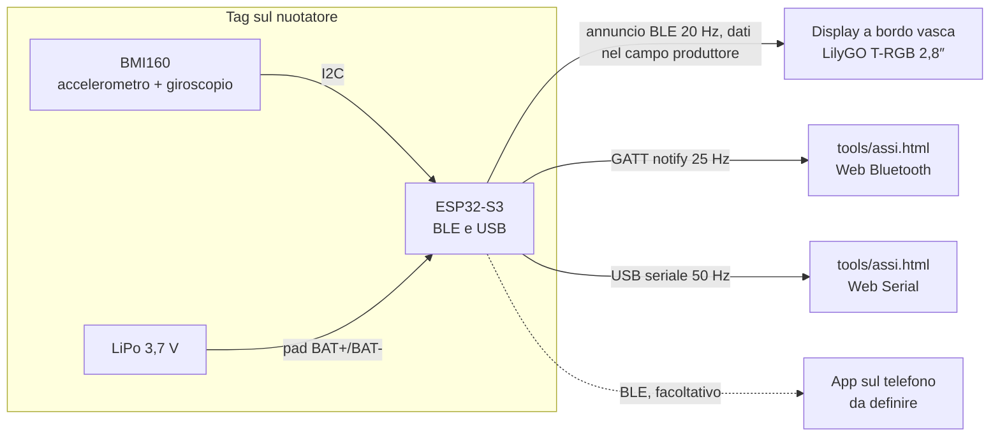

# SwimTimer

Tempi automatici in piscina: un tag indossato dal nuotatore e un display a bordo vasca riconoscono partenza e arrivo, senza pulsanti.

-yellow) 

**Foto dei dispositivi:** da definire (da aggiungere in `docs/foto/`).

## Indice
- [Panoramica](#panoramica)
- [Funzionalità](#funzionalità)
- [Architettura](#architettura)
- [Hardware](#hardware)
- [Firmware](#firmware)
- [Costruzione e assemblaggio](#costruzione-e-assemblaggio)
- [Uso in vasca](#uso-in-vasca)
- [App](#app)
- [Struttura delle cartelle](#struttura-delle-cartelle)
- [Stato del progetto e roadmap](#stato-del-progetto-e-roadmap)
- [Contribuire](#contribuire)
- [Licenza](#licenza)
- [Autore](#autore)

## Panoramica

**Problema.** In piscina i tempi per vasca e i riposi si perdono. Il cronometro a muro non sempre c'è, e guardare l'orologio interrompe l'allenamento.

**A chi serve.** A chi nuota in vasca e vuole tempi e riposi senza toccare nulla durante la prova.

**Cosa fa.** Un piccolo tag, fissato alla cuffia o all'elastico degli occhialini, misura il movimento con un sensore inerziale. Riconosce la spinta dal muro (partenza), la calma all'arrivo (stop) e le virate. Un display a bordo vasca mostra i tempi.

Il BLE non attraversa l'acqua: il tempo non si misura con il segnale radio. Il BLE serve a riconoscere la vicinanza al display e a inviare i dati.

Analisi completa e ipotesi di logica: [`docs/IDEA.md`](docs/IDEA.md).

## Funzionalità

| Funzione | Stato |
|---|---|
| Lettura di accelerazione (3 assi) e rotazione (3 assi) dal sensore BMI160 | Prototipo verificato |
| Invio dei dati grezzi via USB a circa 50 Hz | Prototipo verificato |
| Servizio BLE (GATT) con i campioni a 25 Hz, per la pagina Web Bluetooth | Prototipo, da verificare sul campo |
| Annuncio BLE con l'ultimo campione a 20 Hz, letto dal display senza collegarsi | Prototipo sul tavolo |
| Visualizzazione dei 3 assi con grafici nel browser, via USB o Bluetooth | Funzionante (`tools/assi.html`) |
| Corona dei 3 assi sul display (un giro ogni 15 s) | Prototipo sul tavolo (`firmware/display-prova`) |
| Cronometro di prova sul display: partenza, arrivo, azzeramento | Prototipo sul tavolo, non ancora provato in vasca |
| Riconoscimento della partenza dalla spinta | Prototipo sul display; da portare sul tag |
| Riconoscimento dell'arrivo (tag vicino e calmo per 3 s) | Prototipo sul display; soglia di vicinanza da tarare |
| Conteggio delle virate, registrate come parziali | Da sviluppare |
| Percentuale della batteria e stato di carica | Da sviluppare (serve il partitore 2×100 kΩ) |
| Registrazione dei dati in memoria per le prove in vasca | Da sviluppare |
| Display a bordo vasca con i tempi | Prototipo (LilyGO T-RGB 2,8″) |
| App di accompagnamento e storico | Da definire (facoltativa) |

## Architettura

Schema a blocchi dei componenti del prototipo e dei collegamenti previsti:



### Tag
- **Microcontrollore:** ESP32-S3 SuperMini (USB-C, LED RGB, pulsanti BOOT e RST).
- **Sensore:** Bosch BMI160 su modulo GY-BMI160, 6 assi, indirizzo I2C `0x68`. Non ha magnetometro.
- **Alimentazione:** LiPo a una cella sui pad BAT+ e BAT- dell'ESP32-S3. Il caricatore è integrato nella scheda.
- **Bluetooth:** libreria BLE del core `esp32` 3.3.12. NimBLE-Arduino non è usata: con questo core va in crash.
- **Contenitore:** da definire.

### Display
LilyGO T-RGB 2,8″: ESP32-S3, display rotondo IPS 480×480 con controller ST7701S, touch GT911, microSD e connettore batteria. Non si collega al tag: legge gli annunci BLE e calcola il tempo. Il firmware di prova è in `firmware/display-prova`. Va protetto con una custodia trasparente e a tenuta, da definire.

### Canali di comunicazione del tag

| Canale | Contenuto | Frequenza | Chi lo legge |
|---|---|---|---|
| Seriale USB | riga `D,` per campione (valori convertiti) | circa 50 Hz | `tools/assi.html` (Web Serial) |
| Servizio GATT `7a1e0001-…` | 16 byte: millis e 6 valori grezzi | 25 Hz, con client collegato | `tools/assi.html` (Web Bluetooth) |
| Annuncio BLE `SwimTag` | 1 byte contatore e 6 valori grezzi nel campo produttore `0xFFFF` | 20 Hz, senza collegamento | display T-RGB |

Formato dei dati (valori grezzi, little-endian): accelerazione in unità di 1/16384 g, giroscopio in unità di 1/16,4 °/s.

### Flusso dei dati, dal sensore al tempo
1. Il BMI160 misura accelerazione e rotazione.
2. L'ESP32-S3 legge il sensore via I2C (GPIO 8 SDA, GPIO 9 SCL).
3. Il tag trasmette i campioni sui tre canali della tabella sopra.
4. Il display riceve gli annunci `SwimTag`. Il contatore rileva i campioni persi e l'RSSI (media mobile) stima la vicinanza.
5. Il cronometro di prova sul display applica la logica di rilevamento. START: variazione del modulo dell'accelerazione oltre 0,8 g rispetto a 1 g. STOP: tag vicino (RSSI sopra −72 dBm) e fermo per 3 s. L'ora dello STOP è quella dell'ultimo movimento, non quella della fine della calma.
6. Il display mostra il tempo.

Previsto ma non ancora realizzato: il tag rileva START e STOP, salva gli eventi con l'ora e li invia al display via BLE. Oggi la logica gira sul display, per le prove sul tavolo.

## Hardware

Distinta completa: [`hardware/bom.md`](hardware/bom.md). Schema e collegamenti: [`hardware/schema.md`](hardware/schema.md).

| Componente | Modello | Funzione |
|---|---|---|
| Microcontrollore | ESP32-S3 SuperMini | logica, BLE, USB |
| Sensore inerziale | GY-BMI160 | accelerazione e rotazione |
| Batteria | LiPo 3,7 V, una cella (capacità da scegliere, indicativamente 300–500 mAh) | alimentazione |
| Partitore (facoltativo) | 2 resistenze da 100 kΩ | lettura del livello batteria |
| Display | LilyGO T-RGB 2,8″ (ESP32-S3, rotondo 480×480, touch GT911) | tempi a bordo vasca |

### Collegamenti del tag (prototipo)

| Da | A | Note |
|---|---|---|
| ESP32-S3 3V3 | BMI160 3V3 | alimentazione del sensore |
| ESP32-S3 GND | BMI160 GND | |
| ESP32-S3 GPIO 8 | BMI160 SDA | I2C |
| ESP32-S3 GPIO 9 | BMI160 SCL | I2C |
| ESP32-S3 GPIO 4 | BMI160 INT1 | risveglio al movimento (per il risparmio energia) |
| ESP32-S3 3V3 | BMI160 CS | CS alto: modalità I2C |
| ESP32-S3 GND | BMI160 SAO | indirizzo `0x68` |
| GPIO 1 | partitore sulla batteria | facoltativo, non ancora montato |

Lo schema dettagliato è in [`hardware/schema.md`](hardware/schema.md).

### Alimentazione e autonomia
- La LiPo del tag va sui pad BAT+ e BAT- dell'ESP32-S3. La scheda gestisce la carica dalla USB-C.
- Usare una LiPo con protezione propria: il caricatore integrato non protegge dalla scarica eccessiva.
- Con la batteria scarica il regolatore dà meno di 3,3 V: il firmware deve spegnersi sotto circa 3,3 V.
- Il display usa una LiPo da 1000 mAh sul connettore della T-RGB (caricatore TP4065). Controllare la polarità prima di collegarla.
- Il display va in sonno profondo dopo 5 minuti senza tag.
- Capacità della batteria del tag, autonomia e metodo di spegnimento: da definire.

### Impermeabilità
Da definire. Ipotesi: involucro sigillato con resina o guscio, da provare in vasca con sacchetto stagno.

## Firmware

Il repository contiene due firmware di prova e una pagina di controllo. Il firmware di registrazione in memoria non è ancora scritto.

### `firmware/test-collegamenti/` (tag)
Sketch per il tag. Esegue in sequenza:
- scansione del bus I2C sui pin 8 e 9, anche con SDA e SCL scambiati;
- lettura del chip ID del BMI160, atteso `0xD1`;
- accensione di accelerometro e giroscopio in modalità normale, con verifica dello stato (`0x14`);
- invio di una riga dati USB per campione, a circa 50 Hz. Fondo scala: ±2 g e ±2000 °/s;
- servizio GATT BLE, con nome `SwimTag`:
  - servizio `7a1e0001-5b1d-4c8e-9f3a-1d2c3b4a5e60`, caratteristica `7a1e0002-5b1d-4c8e-9f3a-1d2c3b4a5e60` (lettura e notifica);
  - 16 byte: `uint32` con i millisecondi, poi sei `int16` grezzi `ax, ay, az, gx, gy, gz`. Notifica a 25 Hz con un client collegato;
- annuncio BLE a 20 Hz, con nome `SwimTag` e dati nel campo produttore `0xFFFF` (sperimentale): 1 byte contatore, poi sei `int16` grezzi nello stesso ordine. Il servizio GATT è indicato nella risposta alla scansione;
- diagnostica una volta al secondo: stato del sensore, livello di INT1 e tensione della batteria (se il partitore è montato).

Formato delle righe dati USB:
```
D,<millisecondi>,<ax g>,<ay g>,<az g>,<gx °/s>,<gy °/s>,<gz °/s>
```
Le altre righe sono diagnostica.

### `firmware/display-prova/` (display)
Sketch per la LilyGO T-RGB 2,8″. Riceve gli annunci `SwimTag` senza collegarsi al tag.
- **Corona:** le 3 linee dell'accelerazione (X rosso, Y verde, Z blu) in senso orario. Un giro dura 15 s (300 campioni a 20 Hz). Un campione perso lascia un'interruzione.
- **Cronometro di prova:** parte con un colpo secco. Si ferma quando il tag è vicino e fermo per 3 s, con l'ora dell'ultimo movimento. Un tocco azzera.
- **Doppio framebuffer:** il disegno avviene nel buffer nascosto, che viene mostrato al vsync. Niente tremolio.
- **Diagnostica USB** a 115200 baud, una riga `R,` al secondo: RSSI, media, campioni ricevuti, stato del cronometro, tempo.

- **Sonno profondo:** dopo 5 minuti senza tag il display si spegne. Si risveglia con il tocco (GPIO 1, INT del touch, con pull-up RTC durante il sonno) o con il pulsante BOOT (GPIO 0, ext0). I confronti dei tempi sono con segno: corretto il bug che lo rimandava subito in sonno dopo il risveglio.
- **Motivo dell'avvio:** per 2 s all'accensione il display mostra la causa (accensione, tocco, BOOT, errore, tensione bassa, watchdog). Sonno e risveglio al tocco verificati sulla scheda.
- **Batteria:** tensione e percentuale sul display, dal partitore interno della T-RGB.
- **Da collegare:** accelerometro I2C (SDA 8, SCL 48).

Parametri principali, in testa allo sketch: soglia di vicinanza −72 dBm, tag perso dopo 3 s, spinta 0,8 g, calma sotto 0,10 g e 20 °/s per 3 s. Da tarare in vasca.

Driver del display: `firmware/display-prova/src/trgb/`. È una copia adattata di LilyGo-T-RGB 1.0.5, senza `LV_Helper`, con SensorLib 0.3 e doppio framebuffer. Licenza MIT, Copyright 2024 Xinyuan-LilyGO: vedi `firmware/display-prova/src/trgb/LICENSE`.

### `tools/assi.html` (pagina di controllo)
Pagina HTML che mostra valori e grafici dei 3 assi di accelerazione e rotazione.
- **USB:** pulsante **Collega il tag**. Richiede Chrome o Edge (Web Serial API) e mostra solo le porte con vendor USB `0x303a` (Espressif). Finestra del grafico di 5 s a circa 50 Hz.
- **Bluetooth:** pulsante **Collega via Bluetooth**. Richiede Chrome o Edge su desktop e Android (Web Bluetooth). Cerca il dispositivo `SwimTag` e legge il servizio GATT a 25 Hz. Non si riconnette da sola: alla disconnessione torna allo stato iniziale.
- Se il browser non ha un'API, il pulsante corrispondente resta disabilitato con un avviso.

### Compilazione e caricamento
Requisiti: [Arduino CLI](https://arduino.github.io/arduino-cli/) e il core `esp32:esp32` versione 3.3.12 (per esempio con `arduino-cli core install esp32:esp32@3.3.12`).

Librerie per il display, da installare dal Library Manager o con `arduino-cli lib install`:
- **Adafruit GFX Library** (tela e font);
- **SensorLib**, serie 0.3 (touch GT911).

Sostituire `<COM>` con la porta seriale (per esempio `COM5`).

Tag, dalla USB dell'ESP32-S3:
```
arduino-cli compile --fqbn esp32:esp32:esp32s3:CDCOnBoot=cdc --upload -p <COM> firmware/test-collegamenti
```

Display, dalla USB della T-RGB. La prima compilazione è lunga:
```
arduino-cli compile --fqbn "esp32:esp32:esp32s3:CDCOnBoot=cdc,FlashSize=16M,PartitionScheme=app3M_fat9M_16MB,PSRAM=opi" --upload -p <COM> firmware/display-prova
```

L'opzione `CDCOnBoot=cdc` manda la seriale sulla USB dell'ESP32-S3. Il monitor seriale va impostato a 115200 baud.

### Funzioni previste
- Registrazione in memoria di accelerazione, rotazione e segnale BLE per le prove in vasca.
- Logica di START, STOP e virate sul tag, con la soglia di calma (circa 3 s).
- Percentuale della batteria, con il partitore montato.
- Sonno profondo con risveglio dal BMI160 su INT1.

Test automatici: da definire (`pio test` non è ancora impostato).

## Costruzione e assemblaggio

Procedura del prototipo:
1. Verificare i componenti con [`hardware/bom.md`](hardware/bom.md).
2. Saldare il BMI160 all'ESP32-S3 secondo la tabella [Collegamenti del tag](#collegamenti-del-tag-prototipo).
3. Collegare la LiPo ai pad BAT+ e BAT- e verificare la polarità prima di collegarla.
4. Caricare `firmware/test-collegamenti` e controllare il messaggio `BMI160 chip ID: 0xD1 (OK)`.
5. Aprire `tools/assi.html` e verificare i valori con il tag fermo, via USB o Bluetooth:
   - un asse di accelerazione vale circa ±1 g e gli altri circa 0 g;
   - il giroscopio vale circa 0 °/s su tutti gli assi.
6. Muovere il tag e verificare che ogni asse risponda.
7. Collegare la batteria alla T-RGB e caricare `firmware/display-prova`. Con il tag acceso, il display mostra la corona e il tag vicino.

Involucro e fissaggio al nuotatore: da definire.

## Uso in vasca

Stato: il cronometro di prova funziona sul tavolo. Le prove in vasca non sono ancora state fatte.

Ipotesi di funzionamento (dettagli in [`docs/IDEA.md`](docs/IDEA.md)):
- **Posizione:** cuffia o elastico degli occhialini, dietro la testa. È la parte che emerge più spesso e più vicina al muro.
- **Partenza (START):** picco di spinta dal muro, misurato dall'accelerometro.
- **Virata:** dura meno di 1–2 s ed è seguita da una nuova spinta. Viene registrata come virata parziale e non ferma il cronometro.
- **Arrivo (STOP):** tag vicino al display e calma per almeno circa 3 s. L'ora è quella della decelerazione all'arrivo.
- **Riposo:** dallo STOP alla spinta successiva.
- **Display:** previsto sul lato di partenza, con distanze multiple di 100 m.

Domande aperte per le prove (piscina da 25 o 50 m, tipo di prova, custodia del display): [`docs/DOMANDE-APERTE.md`](docs/DOMANDE-APERTE.md).

## App

Da definire. L'app è facoltativa e servirebbe per lo storico sul telefono. La pagina `tools/assi.html` è uno strumento di controllo, non l'app.

Se verrà sviluppata, seguirà questi vincoli del progetto:
- backend Firebase con piano gratuito Spark, senza Cloud Functions e senza spese;
- sicurezza affidata alle regole di Firestore.

Installazione, avvio, test e deploy: da definire.

## Struttura delle cartelle

```
SwimTimer/
├── docs/                    idea, stato, decisioni, domande aperte, requisiti, design
├── hardware/                distinta componenti (bom.md), schema (schema.md); involucro da creare
├── firmware/
│   ├── test-collegamenti/   tag: test del BMI160, uscita USB, servizio GATT e annuncio BLE
│   └── display-prova/       display T-RGB: ricezione degli annunci, corona e cronometro di prova
│       └── src/trgb/        driver del display (copia adattata, licenza MIT)
├── tools/                   assi.html: visualizzazione dei 3 assi via USB o Bluetooth
├── .claude/                 agenti e comandi per Claude Code (non è codice del prodotto)
├── CHANGELOG.md             modifiche per data
├── CLAUDE.md                regole di lavoro del progetto
├── .gitignore               esclude segreti, dati personali e file di build
└── README.md                questo file
```

Esclusi da git (vedi `.gitignore`): file con segreti (`.env`, chiavi, account di servizio) e la cartella `dati/` per le sessioni di nuoto reali.

## Stato del progetto e roadmap

**Fase 1: prototipo di tag e display.** Il tag trasmette i dati via USB, GATT e annuncio BLE. Il display di prova riceve l'annuncio e mostra la corona e il cronometro di prova. Entrambi funzionano sul tavolo.

Prossimi passi:
1. Caricare sul tag l'ultimo firmware (annuncio con i dati) e provare corona e cronometro sul tavolo.
2. Montare il partitore 2×100 kΩ (BAT+ → GPIO 1 → GND), poi percentuale della batteria e stato di carica su tag, display e pagina.
3. Tarare la soglia di vicinanza e la calma; firmware di registrazione in memoria per la prova in vasca.
4. Involucro impermeabile e fissaggio al nuotatore, con custodia del display.
5. App di accompagnamento, se confermata.

Problemi aperti (dettagli in [`docs/STATO.md`](docs/STATO.md)):
- il BLE non attraversa l'acqua: la logica usa l'accelerometro, il BLE serve per vicinanza e invio;
- il display a batteria, senza USB, non si accende: da verificare polarità e tensione;
- protezione della batteria e metodo di spegnimento del tag da definire;
- capacità della LiPo del tag e autonomia da definire;
- la compilazione è lenta perché le librerie sono in OneDrive: valutare lo spostamento;
- nessun test automatico.

Decisioni: [`docs/DECISIONI.md`](docs/DECISIONI.md). Modifiche: [`CHANGELOG.md`](CHANGELOG.md).

## Contribuire

Il progetto è in fase di prototipo. Segnalazioni e proposte sono benvenute come issue. Linee guida per le pull request: da definire.

Regole del repository:
- nessuna credenziale nel codice o nei documenti;
- nessun dato personale reale: le sessioni di nuoto sono dati di salute e restano in locale, nella cartella `dati/` esclusa da git. Nei test si usano solo dati inventati.

## Licenza

Progetto: da definire. Il repository non contiene ancora un file `LICENSE`.

Componenti di terze parti: il driver in `firmware/display-prova/src/trgb/` è distribuito con licenza MIT (Copyright 2024 Xinyuan-LilyGO), con il suo file [`LICENSE`](firmware/display-prova/src/trgb/LICENSE).

## Autore

PZero (GitHub `PZero`).
